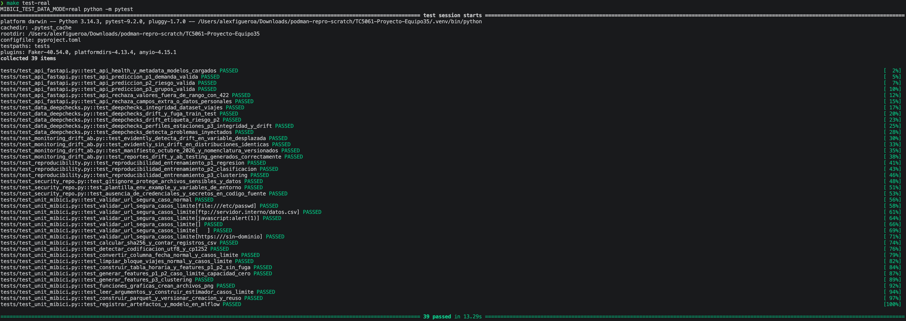
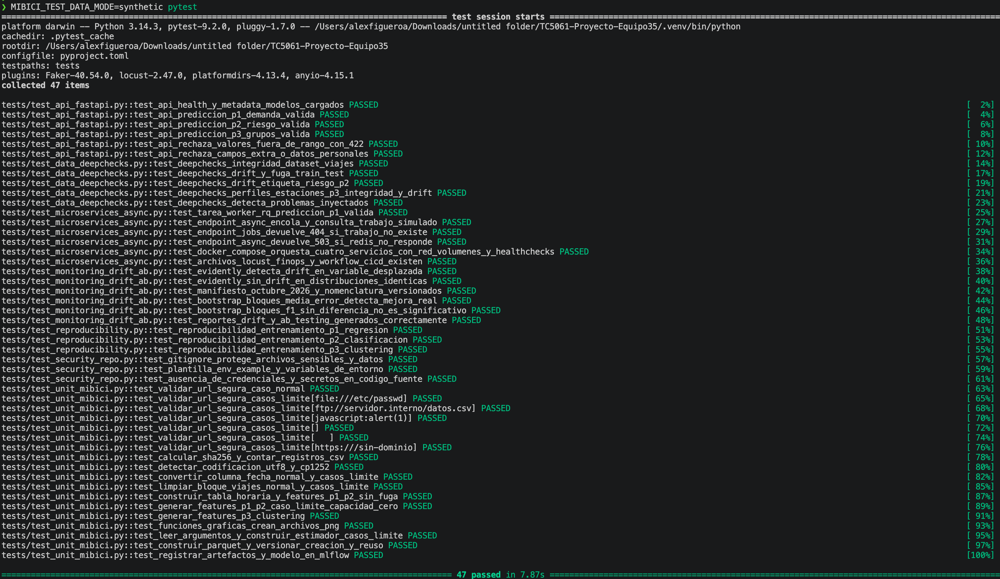
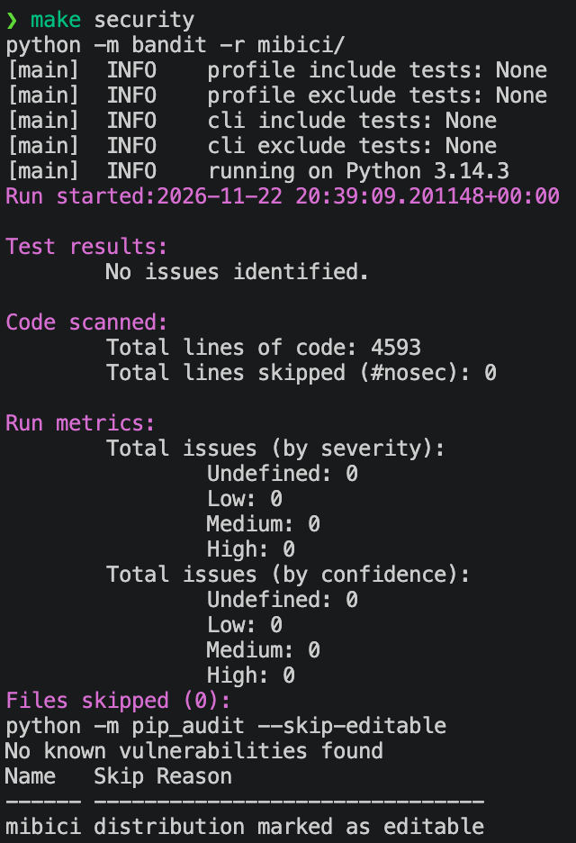
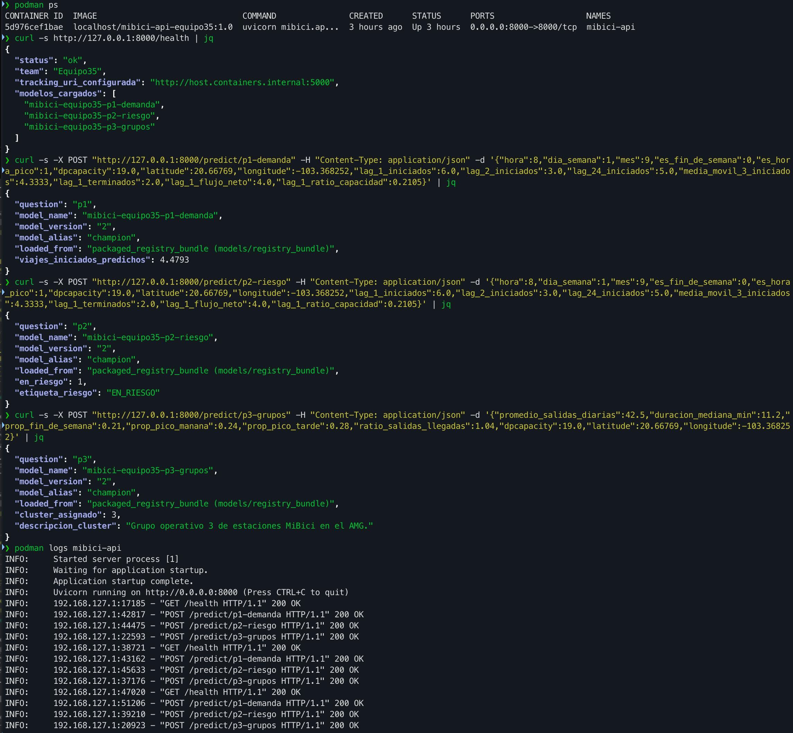
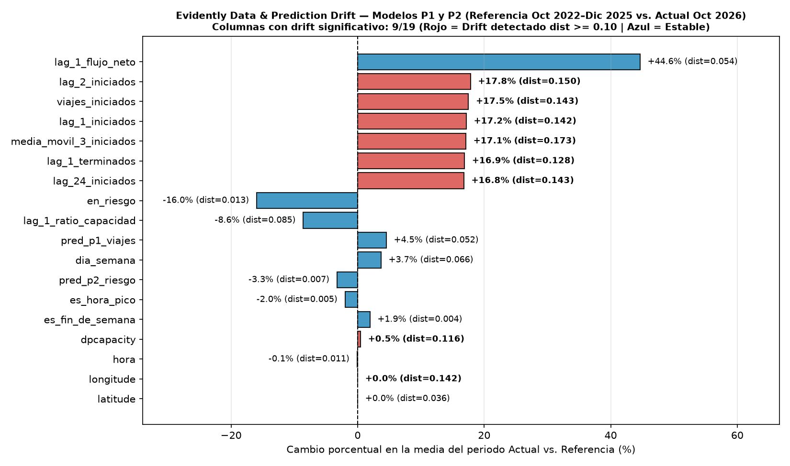
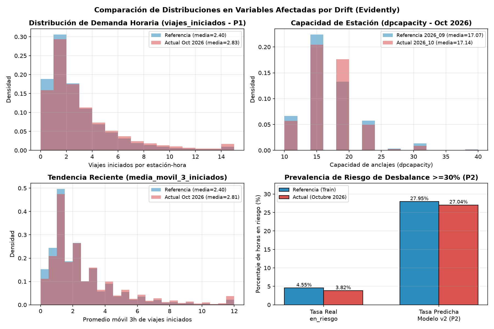
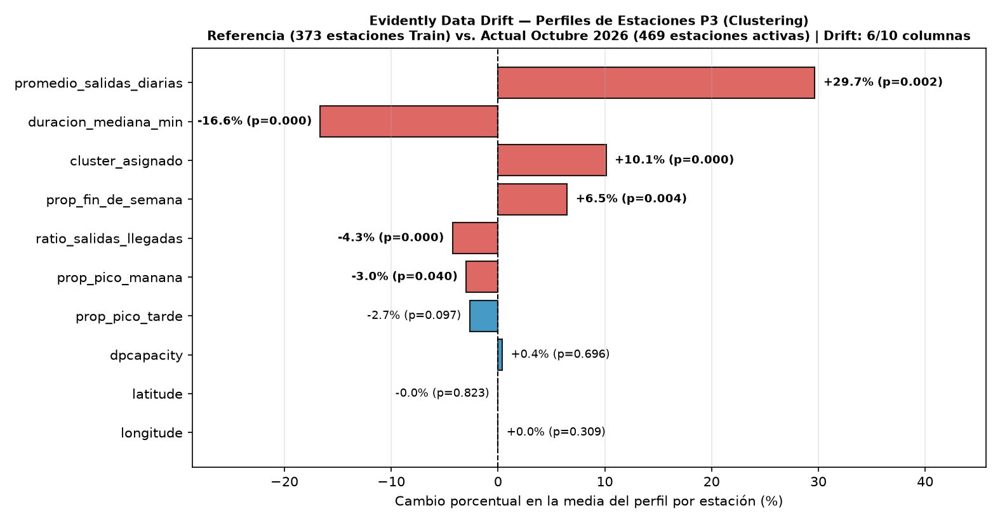
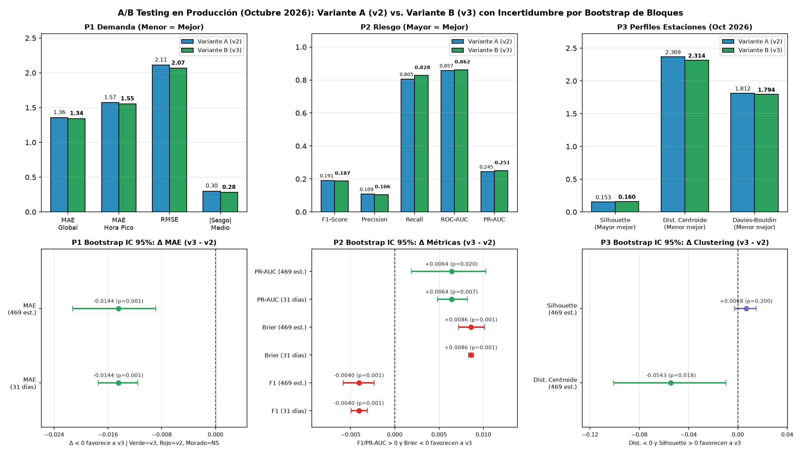

# TC5061 - Proyecto Integrador MiBici (Equipo 35)
## MLflow Project, Tracking Avanzado y Model Registry

Repositorio del **Equipo 35** para el análisis operativo y modelado predictivo del sistema de bicicletas públicas **MiBici** en el Área Metropolitana de Guadalajara (AMG), utilizando datos abiertos del periodo post-pandemia **octubre de 2022 a septiembre de 2026** (48 meses, 17,036,839 viajes limpios, versión de datos `128979137b46`).

---

## 1. Preguntas de Negocio y Tareas de Machine Learning

| Código | Pregunta de Negocio | Tipo de Tarea | Variable Objetivo / Unidad y horizonte | Usuario final y decisión operativa |
| :--- | :--- | :--- | :--- | :--- |
| **P1** | ¿Cuántos viajes se iniciarán en una estación en la siguiente hora? | **Regresión** | `viajes_iniciados` (Estación $\times$ Hora, predicción para la siguiente hora $t$) | **Operador del sistema:** dimensionar la flota activa y anticipar picos horarios de demanda. |
| **P2** | ¿Una estación estará en riesgo de desbalance ($\ge 30\%$ de su capacidad) en la siguiente hora? | **Clasificación binaria** | `en_riesgo` (Estación $\times$ Hora; riesgo $= 1$ si $\Vert{}\text{salidas}_t - \text{llegadas}_t\Vert{} \ge 0.30 \times \text{dpcapacity}$) | **Equipo de rebalanceo:** priorizar el envío de camionetas de redistribución antes de que la estación se vacíe o se sature. |
| **P3** | ¿Qué grupos de estaciones comparten patrones de uso y dónde se ubican en la ciudad? | **Clustering** | Grupos de estaciones (`Estacion_Id`; resumen histórico de comportamiento y coordenadas) | **Planeación urbana y expansión:** diseñar políticas diferenciadas por zona metropolitana y planear nuevas estaciones. |

**Partición estrictamente temporal (sin fuga de información del futuro):**
* **Entrenamiento (Train):** Octubre 2022 – Diciembre 2025 (39 meses).
* **Validación (Validation):** Enero 2026 – Mayo 2026 (5 meses).
* **Prueba (Test):** Junio 2026 – Septiembre 2026 (4 meses).

Se mantienen la misma partición y las mismas métricas de la entrega anterior para que la comparación de cada corrida contra su *baseline* sea válida.

---

## 2. Datos Utilizados y Mecanismo de Versionado

* **Fuente oficial:** Portal de Datos Abiertos de MiBici (`https://mibici.net/es/datos-abiertos/`).
* **Rango temporal seleccionado:** **Octubre de 2022 a Septiembre de 2026** (`2022-10_a_2026-09`, 48 archivos CSV mensuales de viajes más el catálogo `nomenclatura_2026_09.csv`).
* **Justificación del rango:** El 13 de octubre de 2022 se publicó en el Periódico Oficial *El Estado de Jalisco* el Acuerdo Gubernamental `DIELAG ACU 065/2022`, que abrogó las medidas sanitarias obligatorias por COVID-19, normalizando los patrones de movilidad urbana.
* **Volumen y limpieza aplicada (`mibici/dataset.py`):**
  * **Filas crudas leídas:** `17,927,033` registros.
  * **Filas limpias escritas en Parquet:** `17,036,839` registros (se eliminaron `889,481` viajes menores a 121 segundos y `713` duplicados exactos; se estandarizaron `15,859` años de nacimiento fuera de `[1900, 2026]` y `116,260` valores nulos/vacíos de `Genero`).
  * **Estaciones:** `484` estaciones en catálogo (`473` estaciones con viajes activos en el periodo).
  * El detalle de cada regla de limpieza está en `references/README_proceso_datos_mibici.txt`.
* **Mecanismo de versionado (`data/processed/data_version.json`):** Al terminar la ingesta, `mibici/dataset.py` calcula con `hashlib.sha256` el hash criptográfico y el conteo de filas de cada uno de los 48 archivos CSV, del catálogo de nomenclatura y del archivo consolidado `datos_mibici.parquet`. La versión oficial del bloque histórico base (Oct 2022 – Sep 2026) es **`128979137b46`** (primeros 12 caracteres del SHA-256 de `datos_mibici.parquet`).
* **Lote de producción para monitoreo de *drift* y *A/B Testing* (Octubre 2026):** Se integró de forma independiente el corte mensual `datos_abiertos_2026_10.csv` (`635,532` registros crudos; `589,672` viajes limpios en `datos_mibici_2026_10.parquet`, versión SHA-256 **`3542d1d567e1`** registrada en `data/processed/data_version_2026_10.json`) junto con el catálogo actualizado `nomenclatura_2026_10.csv` (`470` estaciones en catálogo, `469` estaciones activas en viajes).
* **Trazabilidad en MLflow:** Cada corrida registra la versión de datos como etiqueta y parámetro (`data_version`), sube el manifiesto `data_version.json` como artefacto (`data/`) y registra una muestra del conjunto de entrenamiento con `mlflow.log_input` usando la versión de datos como *digest*.
* **Privacidad:** Los modelos solo usan variables agregadas por estación y hora (o por estación en P3). Las columnas personales (`Usuario_Id`, `Genero`, `Año_de_nacimiento`) nunca se usan como variables ni se registran en MLflow.

---

## 3. Estructura del Repositorio (Cookiecutter Data Science + MLproject)

El proyecto fue generado con `cookiecutter-data-science` (`ccds`) activando `include_code_scaffold = Yes` y se extendió con un MLflow Project:

```text
├── .gitignore               <- Excluye datos crudos/procesados, modelos, mlruns/, mlartifacts/ y mlflow.db
├── LICENSE
├── Makefile                 <- Atajos de línea de comandos para ingesta, servidor y registro
├── MLproject                <- Definición del MLflow Project (entry points: ingest, train, register, monitor_drift, ab_test)
├── python_env.yaml          <- Entorno del MLflow Project con versiones fijas de Python y dependencias
├── pyproject.toml           <- Metadatos del paquete instalable mibici
├── requirements.txt         <- Dependencias fijas con versiones exactas (==)
├── README.md                <- Documentación de reproducción, servidor MLflow y Model Registry
├── data/
│   ├── external/
│   ├── interim/             <- Caché local de tablas de features (ignorado en Git)
│   ├── processed/
│   │   ├── data_version.json         <- Manifiesto SHA-256 del bloque histórico base (128979137b46)
│   │   └── data_version_2026_10.json <- Manifiesto SHA-256 del lote de producción Oct 2026 (3542d1d567e1)
│   └── raw/                 <- Archivos CSV mensuales y snapshots versionados de nomenclatura (2026_09 y 2026_10)
├── mibici/
│   ├── __init__.py
│   ├── config.py            <- Configuración centralizada (rutas, fechas, semilla, hiperparámetros y Registry)
│   ├── dataset.py           <- Punto de entrada 'ingest': descarga, limpieza, Parquet y data_version.json
│   ├── features.py          <- Ingeniería de características sin fuga de datos (rezagos temporales .shift)
│   ├── plots.py             <- Generación de gráficas de desempeño para P1, P2 y P3
│   ├── api/                 <- Servicio API REST con FastAPI y carga híbrida desde Model Registry
│   ├── modeling/
│   │   ├── __init__.py
│   │   ├── train.py         <- Punto de entrada 'train': baselines, nested runs, candidatos y artefactos
│   │   └── predict.py       <- Punto de entrada 'register': registro en Model Registry (@champion) e inferencia
│   └── monitoring/          <- Observabilidad, Data Drift con Evidently (drift_report.py) y A/B Testing (ab_testing.py)
├── models/                  <- Carpeta para modelos locales (ignorada en Git)
├── notebooks/
│   └── 1.0-equipo35-exploracion-mibici.ipynb
├── references/
│   ├── README_proceso_datos_mibici.txt <- Documentación detallada de las reglas de limpieza
│   ├── arquitectura_equipo35.md        <- Diagrama y justificación de arquitectura
│   └── ml_canvas_equipo35.md           <- ML Canvas del proyecto
├── reports/
│   ├── figures/             <- Gráficas de desempeño (P1, P2, P3), evidencias, Evidently Drift y A/B Testing
│   └── monitoring/          <- Reportes interactivos HTML de Evidently y resúmenes JSON de Drift y A/B Testing
└── tests/                   <- Suite automatizada de 39 pruebas (PyTest, Reproducibilidad, DeepChecks, Seguridad, API y Evidently)
```
---

## 4. Reproducción desde un Clon Limpio con `mlflow run`

**Paso 1: Clonar el repositorio y crear el entorno virtual**

```bash
git clone https://github.com/figueroa-alex/TC5061-Proyecto-Equipo35.git
cd TC5061-Proyecto-Equipo35

python3 -m venv .venv
source .venv/bin/activate
pip install --upgrade pip
pip install -r requirements.txt
pip install -e .
```

**Paso 2: Levantar el servidor local de MLflow Tracking con SQLite (Terminal 1)**

El Model Registry requiere un almacenamiento respaldado por base de datos. Abre una primera terminal en la raíz del proyecto, activa el entorno y levanta el servidor local en el puerto `5000`:

```bash
source .venv/bin/activate
mlflow server --backend-store-uri sqlite:///mlflow.db --port 5000
```
*(La interfaz web estará disponible en `http://127.0.0.1:5000`. El archivo `mlflow.db` y la carpeta `mlartifacts/` están excluidos en `.gitignore`).*

**Paso 3: Configurar variables de entorno y ejecutar la ingesta con `mlflow run` (Terminal 2)**

Abre una segunda terminal en la raíz del proyecto y apunta `MLFLOW_TRACKING_URI` al servidor local y `MLFLOW_EXPERIMENT_NAME` al experimento del equipo (`mibici-equipo35`):

```bash
source .venv/bin/activate
export MLFLOW_TRACKING_URI="http://127.0.0.1:5000"
export MLFLOW_EXPERIMENT_NAME="mibici-equipo35"

# Ejecutar el punto de entrada 'ingest' (descarga/verifica los 48 CSVs, genera Parquet y data_version.json)
mlflow run . -e ingest --env-manager=local
```

**Paso 4: Reproducir toda la experimentación (Baselines, Nested Runs y Candidatos) con `mlflow run`**

**Pregunta 1 (P1 - Regresión de demanda horaria por estación):**

```bash
# 1. Baseline (DummyRegressor - estrategia de la media)
mlflow run . -e train --env-manager=local -P question=p1 -P stage=baseline -P model=dummy

# 2. Búsqueda de hiperparámetros con Nested Runs (1 corrida padre + 4 corridas hijas)
mlflow run . -e train --env-manager=local -P question=p1 -P stage=search -P model=hgb

# 3. Tres corridas candidatas comparables contra el baseline
mlflow run . -e train --env-manager=local -P question=p1 -P stage=candidate -P model=ridge -P alpha=1.0
mlflow run . -e train --env-manager=local -P question=p1 -P stage=candidate -P model=rf -P n_estimators=150 -P max_depth=12
mlflow run . -e train --env-manager=local -P question=p1 -P stage=candidate -P model=hgb -P n_estimators=250 -P max_depth=12 -P learning_rate=0.08
```

**Pregunta 2 (P2 - Clasificación de riesgo de desbalance horario $\ge 30\%$ de capacidad):**

```bash
# 1. Baseline (DummyClassifier estratificado)
mlflow run . -e train --env-manager=local -P question=p2 -P stage=baseline -P model=dummy

# 2. Búsqueda de hiperparámetros con Nested Runs (1 corrida padre + 4 corridas hijas)
mlflow run . -e train --env-manager=local -P question=p2 -P stage=search -P model=hgb_clf

# 3. Tres corridas candidatas comparables contra el baseline
mlflow run . -e train --env-manager=local -P question=p2 -P stage=candidate -P model=logreg -P c_reg=1.0
mlflow run . -e train --env-manager=local -P question=p2 -P stage=candidate -P model=rf_clf -P n_estimators=150 -P max_depth=12
mlflow run . -e train --env-manager=local -P question=p2 -P stage=candidate -P model=hgb_clf -P n_estimators=250 -P max_depth=12 -P learning_rate=0.08
```

**Pregunta 3 (P3 - Clustering de estaciones por perfil operativo y geográfico):**

```bash
# 1. Baseline (K-Means con K=2)
mlflow run . -e train --env-manager=local -P question=p3 -P stage=baseline -P model=kmeans -P n_clusters=2

# 2. Búsqueda de hiperparámetros con Nested Runs (1 corrida padre + 4 corridas hijas para K=3,4,5,6)
mlflow run . -e train --env-manager=local -P question=p3 -P stage=search -P model=kmeans

# 3. Tres corridas candidatas comparables contra el baseline
mlflow run . -e train --env-manager=local -P question=p3 -P stage=candidate -P model=kmeans -P n_clusters=4
mlflow run . -e train --env-manager=local -P question=p3 -P stage=candidate -P model=minibatch_kmeans -P n_clusters=4
mlflow run . -e train --env-manager=local -P question=p3 -P stage=candidate -P model=birch -P n_clusters=4
```

**Paso 5: Consultar la tabla comparativa de corridas (opcional, en cualquier momento)**

```bash
mlflow run . -e register --env-manager=local -P action=summary
```

Imprime en la terminal todas las corridas finalizadas por pregunta (baseline, búsqueda con sus corridas hijas y candidatas) con sus métricas, para apoyar la comparación en la interfaz de MLflow (`http://127.0.0.1:5000`, experimento `mibici-equipo35`).

---

## 5. Gestión del Model Registry y Esquema de Ciclo de Vida (Aliases)

Una vez entrenadas todas las corridas y elegido el modelo de cada pregunta, se promueven a producción y se verifica que se pueden cargar por su nombre y alias:

```bash
mlflow run . -e register --env-manager=local -P action=register_and_verify
```

> **Registro automático:** para cada pregunta, el script toma las corridas con `stage_of_work = candidate` y estado `FINISHED`, asigna `@champion` a la mejor y `@challenger` a la segunda según la métrica de validación (P1: menor `val_mae`; P2: mayor `val_f1`; P3: mayor `train_silhouette`). Antes de ejecutarlo, el equipo confirma que este orden coincide con el modelo elegido y justificado en el reporte. Se ejecuta **una sola vez** en el servidor oficial, porque cada ejecución crea nuevas versiones en el registro.

**Modelos registrados y URIs de producción**

| Pregunta | Nombre en el Model Registry | Alias en Producción | URI de Carga |
| :---- | :---- | :---- | :---- |
| **P1 (Demanda)** | `mibici-equipo35-p1-demanda` | `@champion` | `models:/mibici-equipo35-p1-demanda@champion` |
| **P2 (Riesgo)** | `mibici-equipo35-p2-riesgo` | `@champion` | `models:/mibici-equipo35-p2-riesgo@champion` |
| **P3 (Grupos)** | `mibici-equipo35-p3-grupos` | `@champion` | `models:/mibici-equipo35-p3-grupos@champion` |

**Justificación del esquema de ciclo de vida mediante Aliases (`@champion` y `@challenger`)**

El equipo adoptó el esquema vigente de Model Registry Aliases (`@champion` para la versión activa en producción y `@challenger` para la segunda mejor versión candidata) en lugar del esquema clásico de etapas (Staging / Production / Archived), el cual se encuentra deprecado a partir de MLflow 2.9+ y 3.x:

1. **Desacoplamiento entre código consumidor y versiones numéricas:** Los sistemas de inferencia (`mibici/modeling/predict.py`) invocan una URI fija (`models:/mibici-equipo35-p1-demanda@champion`). Al actualizar el modelo, basta con reasignar el alias `@champion` a la nueva versión sin modificar el código de producción.

2. **Reversión inmediata (*Rollback*) y pruebas A/B (*Shadow Deployment*):** Mantener asignado el alias `@challenger` al modelo retador permite comparar en paralelo dos modelos candidatos o revertir instantáneamente el puntero `@champion` en caso de degradación operativa.

3. **Linaje completo:** Cada versión registrada conserva sus etiquetas de `git_commit`, `data_version` (`128979137b46`), `run_id` de origen e identificador del experimento `mibici-equipo35`.

---

## 6. Artefactos por Corrida y Gráficas del Reporte

Cada corrida *baseline* y candidata guarda en MLflow los artefactos que respaldan su resultado, organizados en subcarpetas:

| Ubicación en MLflow | Contenido |
| :--- | :--- |
| `data/data_version.json` | Manifiesto de versión de datos generado por la ingesta |
| `config/config.py` y `config/run_config.json` | Configuración del proyecto y parámetros exactos de la corrida |
| `plots/` | Dos gráficas por pregunta: real vs. predicho y residuales (P1), matriz de confusión y curva precisión-recall (P2), mapa y perfiles de los grupos de estaciones (P3) |
| *Logged model* (sección **Logged models** de la corrida) | Modelo registrado con `log_model`, con firma (*signature*) y ejemplo de entrada |
| *Datasets* | Muestra del conjunto de entrenamiento registrada con `mlflow.log_input` (sin datos personales) |

Las corridas de búsqueda (padre e hijas) solo registran parámetros y métricas: son exploratorias, y la mejor combinación se vuelve a entrenar como corrida candidata con todos sus artefactos.

**Gráficas versionadas en Git (`reports/figures/`).** Cada corrida sobrescribe localmente las dos gráficas de su pregunta (`p1_*`, `p2_*` o `p3_*`). El título de cada imagen indica el modelo que la generó. Las gráficas de todas las demás corridas se conservan en MLflow, en la subcarpeta `plots/` de cada corrida.

---

## 7. Flujo de Trabajo Colaborativo con Git y GitHub (Equipo 35)

El equipo adoptó **GitHub Flow** con las siguientes reglas:

1. **Protección de la rama `main`:** La rama `main` está protegida en GitHub y prohíbe *pushes* directos; todo cambio requiere abrir un *Pull Request* (PR) y contar con al menos **1 revisión y aprobación** de otro integrante antes de fusionarse (*merge*).
2. **Convención de nombres de ramas:** Se utiliza el formato `<tipo>/<descripcion-corta-en-kebab-case>`, por ejemplo:
   * Entrega 1: `feat/ingesta-y-configuracion`, `feat/ingenieria-caracteristicas`, `feat/experimento-base-mlflow`, `docs/readme-y-documentacion`.
   * Entrega 2: `feat/mlflow-project-infra`, `feat/experimentacion-artefactos`, `feat/model-registry`, `docs/readme-reporte-entrega2`.
   * Entrega 3: `feat/seguridad-y-configuracion`, `test/unitarias-y-reproducibilidad`, `test/validacion-datos-deepchecks`, `feat/recuperacion-modelo-registry`, `feat/api-fastapi-validacion-pydantic`, `feat/contenedor-podman-containerfile`.
   * Entrega 4 (Monitoreo y A/B Testing): `feat/ingesta-octubre2026-y-config-monitoreo`, `feat/monitoreo-drift-evidently`, `feat/ab-testing-model-registry-v3`, `docs/reporte-drift-abtest-y-pruebas`.
3. **Convención de mensajes de commit:** Basada en *Conventional Commits* 1.0.0 (`feat:`, `fix:`, `docs:`, `refactor:`, `chore:`) seguidos de una descripción concisa en español.
4. **Fusión con *merge commit*:** Los PR se fusionan con *merge commit* (sin *squash*) para conservar los *commits* que quedan registrados en la etiqueta `git_commit` de cada corrida y versión del Model Registry.
5. **Exclusión de artefactos pesados:** El archivo `.gitignore` bloquea cualquier archivo `.csv`, `.parquet`, modelos serializados, `mlruns/`, `mlartifacts/` y `mlflow.db` para mantener el repositorio ligero y auditable.

---

## 8. Equipo 35

| Nombre | Matrícula | Rol |
|---|---|---|
| Alejandro Figueroa Martínez | A01796930 | Científico de Datos |
| Fernando Gómez Moreno | A00354097 | Ingeniero de Datos |
| Luis Pablo Guerrero Garza | A01840428 | Ingeniero de Machine Learning |
| Rosina Flores Ruiz | A01639950 | Analista de Datos |

---

## 9. Pruebas Automatizadas (PyTest + DeepChecks) y Chequeos de Seguridad

En esta entrega se integró al repositorio una suite automatizada de **39 pruebas** en la carpeta dedicada `tests/` (29 pruebas de unidad, reproducibilidad, validación de datos con DeepChecks y seguridad del repositorio, 6 pruebas de los endpoints de la API REST con FastAPI y 4 pruebas de monitoreo de *drift* con Evidently y *A/B testing*) junto con controles de seguridad de código, variables de entorno y auditoría de dependencias para asegurar la calidad, reproducibilidad y gobernanza técnica del proyecto MiBici.

### 9.1 Estructura de la Carpeta `tests/`

```text
tests/
├── __init__.py               <- Inicializador del paquete de pruebas
├── conftest.py               <- Fixtures deterministas (semilla 42) y puente de compatibilidad para DeepChecks
├── test_unit_mibici.py       <- 18 pruebas unitarias (casos normales y límite) de dataset.py, features.py, plots.py y train.py (incluyendo Parquet/versionado y artefactos en MLflow)
├── test_reproducibility.py   <- 3 pruebas de reproducibilidad del entrenamiento (P1 Regresión, P2 Clasificación, P3 Clustering)
├── test_data_deepchecks.py   <- 5 pruebas de validación de integridad, calidad y drift con DeepChecks para viajes crudos, P1, P2 y P3
├── test_security_repo.py     <- 3 pruebas automatizadas de seguridad (.gitignore, .env.example y ausencia de secretos)
├── test_api_fastapi.py       <- 6 pruebas de integración y validación Pydantic del servicio API REST (FastAPI)
└── test_monitoring_drift_ab.py <- 4 pruebas de monitoreo de Data Drift con Evidently, lote Octubre 2026 y A/B Testing
```

---

### 9.2 Cobertura de Pruebas Unitarias y de Reproducibilidad con PyTest (`tests/test_unit_mibici.py` y `tests/test_reproducibility.py`)

| Módulo / Función Clave Probada | Casos Normales Cubiertos | Casos Límite (*Edge Cases*) Cubiertos |
| :--- | :--- | :--- |
| `dataset.validar_url_segura` | Aceptación de URLs oficiales con esquema `https://` y `http://` y dominio válido. | Rechazo con `ValueError` de esquemas no permitidos (`file:///etc/passwd`, `ftp://`, `javascript:`), cadenas vacías o con espacios y URLs sin dominio (`https:///sin-dominio`). |
| `dataset.calcular_sha256_archivo` y `contar_registros_csv` | Cálculo exacto de hash SHA-256 por bloques y conteo de filas de datos descontando el encabezado. | Archivos CSV completamente vacíos (`0 bytes`), devolviendo `0` registros sin producir conteos negativos. |
| `dataset.detectar_codificacion` y `convertir_columna_fecha` | Detección automática `utf-8-sig` vs. `cp1252` (letra `ñ`) y conversión de fechas en formatos ISO (`YYYY-MM-DD HH:MM:SS`) y día-primero (`DD/MM/YYYY HH:MM`). | Series de fecha completamente vacías o con espacios (`NaT`) y rechazo con `ValueError` ante formatos de fecha corruptos o desconocidos. |
| `dataset.limpiar_bloque_viajes` | Conversión de tipos a `Int64`, conservación de viajes válidos ($\ge 121\text{ s}$) y conteo de estadísticas de limpieza. | Eliminación de viajes cortos ($< 121\text{ s}$) y duplicados exactos; enmascaramiento a `pd.NA` de años de nacimiento fuera de `[1900, 2026]` (ej. `1850`, `2099`) y de cadenas `'NULL'`/`''` en `Genero`; manejo seguro de un `DataFrame` vacío (`0` filas). |
| `dataset.construir_parquet_y_versionar` | Procesamiento de archivos CSV hacia `datos_mibici.parquet` aplicando todas las reglas de limpieza y generación del manifiesto `data_version.json` con hashes SHA-256 (`parquet_sha256`, `data_version_short`) y conteos por archivo fuente y catálogo de nomenclatura. | Reutilización segura del archivo Parquet y de los conteos previos cuando `datos_mibici.parquet` y `data_version.json` ya existen en disco, verificando que el hash SHA-256 permanezca invariante sin reprocesar los bloques. |
| `features.construir_tabla_horaria_estaciones` y `generar_features_p1_y_p2` | Agregación horaria por estación, creación de variables de calendario, rezagos temporales (`.shift(1)`, `.shift(2)`, `.shift(24)`), promedio móvil de 3 horas y etiqueta binaria `en_riesgo`. | Verificación matemática contra fuga de datos (*data leakage*) comprobando que `lag_1_iniciados` en la hora $t$ coincida exactamente con `viajes_iniciados` en $t-1$; manejo seguro de estaciones con capacidad cero (`dpcapacity = 0`) evitando divisiones por cero (`ZeroDivisionError`) o valores infinitos. |
| `features.generar_features_p3_clustering` | Construcción del perfil operativo y geográfico por estación sobre el conjunto de entrenamiento. | Estaciones sin llegadas registradas (reemplazo seguro de denominador `0` por `1` en `ratio_salidas_llegadas`) y validación de proporciones en el rango `[0.0, 1.0]`. |
| `plots.*` y `train.leer_argumentos` / `construir_estimador` | Creación de archivos `.png` no vacíos para P1 y P2; reemplazo automático de `"from_config"` por las constantes de `mibici/config.py`. | Rechazo con `ValueError` ante preguntas o nombres de modelos no reconocidos (`p99`, `modelo_inexistente`). |
| `train.registrar_artefactos_y_modelo` | Registro completo en un servidor SQLite de MLflow del dataset de entrenamiento (`mlflow.log_input` con `digest`), manifiesto en `data/data_version.json`, configuración en `config/config.py` y `config/run_config.json`, gráficas en `plots/` y modelo serializado con `signature`, `input_example` y etiqueta `logged_model_uri`. | Verificación de recuperación e inferencia del modelo registrado desde su URI `models:/m-...` comprobando que las predicciones coincidan exactamente con las del modelo en memoria. |
| **Monitoreo de *Drift* con Evidently y *A/B Testing*** (`test_monitoring_drift_ab.py`) | Ejecución de `Report([DataDriftPreset(), DataSummaryPreset()])` verificando detección de *drift* en variables desplazadas, generación de reporte HTML, validación del manifiesto SHA-256 `data_version_2026_10.json` y estructura de resultados A/B (`v2` vs. `v3`) para P1, P2 y P3. | Verificación de caso límite con distribuciones de referencia y actual idénticas (`0` columnas con *drift* y `0` celdas faltantes) y manejo de rutas fuera de `PROJ_ROOT` (`tmp_path`). |
| **Reproducibilidad del entrenamiento** (`test_reproducibility.py`) | Dos ejecuciones independientes con la misma semilla (`RANDOM_SEED = 42`) para **P1** (`HistGradientBoostingRegressor`, `RandomForestRegressor`, `Ridge`), **P2** (`HistGradientBoostingClassifier`, `LogisticRegression`, `RandomForestClassifier`) y **P3** (`KMeans`). | Verificación estricta con `np.testing.assert_allclose` (`rtol=1e-12`, `atol=1e-12`) y `assert_array_equal` de que dos corridas con la misma semilla producen **exactamente las mismas predicciones, probabilidades, asignaciones de cluster y métricas** (`MAE`, `R2`, `F1-Score`, `ROC-AUC` y `Silhouette Score`). |

---

### 9.3 Validación de Calidad, Integridad y *Drift* de Datos con DeepChecks (`tests/test_data_deepchecks.py`)

Las pruebas de `DeepChecks` soportan **dos modos de ejecución** controlados mediante la variable de entorno `MIBICI_TEST_DATA_MODE` (definida en `.env.example` y `mibici/config.py`):

1. **Modo Muestra Real (`MIBICI_TEST_DATA_MODE=real` o `auto` cuando existen los archivos Parquet en disco):** Evalúa una muestra determinista de `10,000` viajes limpios de `data/processed/datos_mibici.parquet`, muestras de `5,000` observaciones de entrenamiento vs. `5,000` de prueba de `data/interim/features_p1_p2.parquet` (tanto para la etiqueta continua `viajes_iniciados` de **P1** como para la etiqueta binaria `en_riesgo` de **P2**), y la tabla de perfiles de estaciones de **P3** (`data/interim/features_p3.parquet`, `373` estaciones en entrenamiento vs. `469` estaciones activas en el periodo de prueba).
2. **Modo Sintético de Respaldo (`MIBICI_TEST_DATA_MODE=synthetic` o `auto` en un clon limpio antes de correr la ingesta):** Evalúa el *dataset* sintético determinista generado en `tests/conftest.py` para que `pytest` sea ejecutable con un solo comando inmediatamente después de clonar el repositorio, incluso antes de descargar los 48 archivos CSV.

#### Hallazgos Documentados de DeepChecks sobre el Dataset Real (Versión `128979137b46`)

| Chequeo de DeepChecks | Dataset / Pregunta Evaluada | Resultado Obtenido | Interpretación Técnica y de Negocio |
| :--- | :--- | :--- | :--- |
| `IsSingleValue` | `datos_mibici.parquet` ($n=10,000$) y `features_p3.parquet` ($n=373$) | `0` columnas constantes en viajes (`Usuario_Id: 4,582`, `Genero: 3`, `Año_de_nacimiento: 62`, `Origen_Id: 299`, `Destino_Id: 300`) y `0` en perfiles P3 (`promedio_salidas_diarias: 371`, `duracion_mediana_min: 257`, `dpcapacity: 8`, `latitude: 372`, `longitude: 372`). | Todas las variables de viajes y las 9 variables agregadas de los perfiles de estaciones conservan variabilidad informativa real. |
| `MixedNulls` | `datos_mibici.parquet` ($n=10,000$) y `features_p3.parquet` ($n=373$) | Viajes: `Año_de_nacimiento` con `36` valores `NaN` (`0.36%`) y `0` tipos de nulos mezclados. Perfiles P3: `{}` (`0` valores nulos en las 9 columnas). | Confirma que `dataset.py` homologó las cadenas `'NULL'` y vacías a un único tipo nulo estándar y que la tabla de perfiles de estaciones P3 está libre de valores faltantes. |
| `MixedDataTypes` | `datos_mibici.parquet`, `features_p3.parquet` y dataset con anomalías inyectadas | `{}` (`0` columnas con tipos mezclados en viajes y en P3). Detecta tipos mezclados cuando se inyecta un entero (`999`) en `Genero`. | Garantiza la integridad de tipos del esquema Parquet (`int64`, `float64`, `datetime64` y `object`). |
| `StringMismatch` y `SpecialCharacters` | `datos_mibici.parquet` (muestra $n=10,000$) | `Genero`: `{}` (`0.0%` de variantes con errores o caracteres especiales). | Confirma la estandarización de categorías en la columna `Genero`. |
| `DataDuplicates` | `datos_mibici.parquet`, `features_p3.parquet` y dataset con anomalías inyectadas | `0.0%` de duplicados exactos en viajes (con `Viaje_Id` y fechas) y `0.0%` en perfiles de estaciones P3 (`373` estaciones únicas); `2.24%` al evaluar solo el perfil de viaje sin fecha ni ID. | La ingesta eliminó los `713` duplicados exactos crudos y cada estación en P3 tiene un registro único. |
| `OutlierSampleDetection` | Dataset de prueba con anomalías inyectadas ($n=120$) | Vector de `1,000` cuantiles LoOP con probabilidad máxima `0.7871` (`> 0.50`). | Confirma que el detector multivariado LoOP identifica registros con conteos de viajes atípicos extremos. |
| `TrainTestSamplesMix` | `features_p1_p2.parquet` (P1 y P2, $n=5,000$ c/u) y perfiles de estaciones **P3** (Train $n=373$ vs. Test $n=469$) | `ratio = 0.0` (`0.0%` de muestras compartidas en P1, P2 y P3). | Comprueba la ausencia de filtración de observaciones entre el periodo de entrenamiento (Oct 2022–Dic 2025) y el de prueba (Jun–Sep 2026) en las tres preguntas. |
| `FeatureDrift` (**P1 y P2**) | `features_p1_p2.parquet` (Train vs. Test, $n=5,000$ c/u) | Variables operativas y de desbalance estables ($< 0.07$): `hora = 0.0075`, `dia_semana = 0.0000`, `es_fin_de_semana = 0.0000`, `es_hora_pico = 0.0011`, `lag_1_iniciados = 0.0326`, `lag_1_terminados = 0.0332`, `lag_1_flujo_neto = 0.0202`, `lag_1_ratio_capacidad = 0.0520`, `dpcapacity = 0.0460`. Variable calendario `mes = 0.7299` (V de Cramer). | El *drift* alto en `mes` (`0.7299`) es esperado por diseño de la partición temporal: Test abarca únicamente junio–septiembre de 2026 (4 meses), mientras que Train abarca los 12 meses del año. Las variables predictoras de demanda y desbalance mantienen distribuciones estables. |
| `LabelDrift` (**P1 — Regresión**) | `features_p1_p2.parquet` (`viajes_iniciados`) | `Drift score = 0.0532` (prueba de Kolmogorov-Smirnov $< 0.20$). | La distribución continua de viajes iniciados por hora es consistente entre entrenamiento y prueba. |
| `LabelDrift` (**P2 — Clasificación**) | `features_p1_p2.parquet` (`en_riesgo`, desbalance $\ge 30\%$ de capacidad) | `Drift score = 0.0305` (V de Cramer $< 0.20$; prevalencia en muestra Train $= 3.98\%$, Test $= 2.80\%$). | La proporción de eventos críticos de riesgo horario se mantiene estable y sin cambio de régimen entre entrenamiento y prueba. |
| `FeatureDrift` (**P3 — Clustering**) | Perfiles de estaciones **P3** en Train ($n=373$) vs. Test ($n=469$) | Las 9 variables operativas y geográficas presentan *drift* bajo (Kolmogorov-Smirnov $< 0.16$): `promedio_salidas_diarias = 0.0990`, `duracion_mediana_min = 0.1404`, `prop_fin_de_semana = 0.1560`, `prop_pico_manana = 0.0707`, `prop_pico_tarde = 0.1246`, `ratio_salidas_llegadas = 0.1536`, `dpcapacity = 0.0524`, `latitude = 0.0391`, `longitude = 0.0644`. | Confirma que la estructura espacial y los hábitos de uso por estación en el AMG son consistentes entre el periodo de entrenamiento y el periodo de prueba (incluyendo las nuevas estaciones incorporadas en 2026). |

---

### 9.4 Chequeos de Seguridad Básicos Implementados

1. **Protección de credenciales y variables de entorno (`.gitignore`, `.env.example` y `mibici/config.py`):**
   * Se integró la plantilla `.env.example` con las variables de entorno del proyecto (`MLFLOW_TRACKING_URI`, `MLFLOW_EXPERIMENT_NAME`, `MIBICI_OPEN_DATA_URL`, `MIBICI_RANDOM_SEED` y `MIBICI_TEST_DATA_MODE`) sin exponer secretos.
   * `mibici/config.py` carga automáticamente las variables desde `.env` mediante `python-dotenv` (`load_dotenv`) y `os.getenv()`.
   * `.gitignore` excluye archivos `.env`, `.env.*` (permitiendo solo `!.env.example`), llaves privadas (`*.pem`, `*.key`, `*.crt`), bases de datos (`mlflow.db`) y archivos de datos pesados (`*.csv`, `*.parquet`).
   * El módulo `tests/test_security_repo.py` verifica en cada corrida de `pytest` que `.gitignore` y `.env.example` estén presentes y escanea todos los archivos `.py` para confirmar la ausencia de tokens (`ghp_`, `AKIA`, `sk-`), llaves privadas o contraseñas escritas en el código.
2. **Análisis estático de seguridad del código fuente con `bandit`:**
   * En la auditoría inicial sobre `mibici/`, `bandit` detectó **5 alertas**: 2 de severidad Media (`B310` en `mibici/dataset.py` por uso de `urlopen` sin validar el esquema de la URL) y 3 de severidad Baja (`B404`, `B603`, `B607` en `mibici/modeling/train.py` por uso de `subprocess.check_output` para leer el hash de Git).
   * **Remediación aplicada:** Se implementó `dataset.validar_url_segura(url)` para permitir exclusivamente esquemas `https` y `http` con dominio válido antes de cualquier descarga, y en `train.py` se sustituyó `subprocess` por `GitPython` (`git.Repo`). Tras estos cambios, `bandit -r mibici/` reporta **0 problemas de seguridad** (`No issues identified`).
3. **Auditoría de vulnerabilidades en dependencias con `pip-audit`:**
   * En la revisión inicial del entorno con `pip-audit`, se detectaron vulnerabilidades conocidas en `certifi` (`PYSEC-2026-4320`), `mlflow` (`CVE-2026-53995`), `setuptools` (`PYSEC-2026-3447`, `GHSA-xmj3-9gf7-h52w`), `tornado` (`CVE-2026-116577`) y `pyasn1` (`CVE-2026-119194`, `CVE-2026-119195`, `CVE-2026-119196`, `CVE-2026-119197`).
   * **Remediación aplicada:** Se actualizaron y fijaron en `requirements.txt` las versiones parcheadas (`certifi==2026.10.23`, `mlflow==3.17.2`, `setuptools==84.2.1`, `tornado==6.6` y `pyasn1==0.6.5`), logrando un resultado limpio de **`No known vulnerabilities found`**.

---

### 9.5 Instrucciones para Ejecutar las Pruebas y los Chequeos de Seguridad

Desde la raíz del repositorio con el entorno virtual activado (`source .venv/bin/activate`):

#### A) Ejecutar la suite completa de pruebas con un solo comando (PyTest + Reproducibilidad + DeepChecks + Seguridad + API)

* **Modo 1 — Con muestra representativa de los archivos Parquet reales (`datos_mibici.parquet`, `features_p1_p2.parquet` y `features_p3.parquet`):**
  Si ya ejecutaste la ingesta y generación de tablas de características, corre:
  ```bash
  pytest
  # O mediante el comando del Makefile:
  make test-real
  ```

* **Modo 2 — Con dataset sintético de respaldo (en un clon limpio sin haber ejecutado aún la ingesta):**
  Si acabas de clonar el repositorio y deseas correr las 39 pruebas de inmediato sin descargar los 48 archivos CSV ni generar el Parquet, ejecuta:
  ```bash
  MIBICI_TEST_DATA_MODE=synthetic pytest
  # O mediante el comando del Makefile:
  make test-synthetic
  ```

#### B) Ejecutar los chequeos de seguridad de código (`bandit`) y de dependencias (`pip-audit`)

```bash
# 1. Análisis de seguridad del código fuente en mibici/
bandit -r mibici/

# 2. Auditoría de vulnerabilidades en dependencias instaladas
pip-audit --skip-editable

# O ejecutar ambos chequeos con un solo comando del Makefile:
make security
```

---

### 9.6 Evidencia de Ejecución Exitosa de Pruebas y Chequeos de Seguridad

**1. Ejecución exitosa de las 39 pruebas automatizadas (PyTest + Reproducibilidad + DeepChecks en P1, P2 y P3 + Seguridad + API) sobre datos reales (`39 passed` sin *warnings*):**



**2. Ejecución exitosa de las 39 pruebas automatizadas usando el dataset sintético de respaldo (`MIBICI_TEST_DATA_MODE=synthetic pytest`, `39 passed` sin *warnings*):**



**3. Ejecución exitosa de los chequeos de seguridad con `bandit` (`No issues identified`) y `pip-audit` (`No known vulnerabilities found`):**



---

## 10. Despliegue del Modelo como Servicio API REST con FastAPI en Contenedor Podman

En esta entrega se empaquetaron los tres modelos campeones del proyecto MiBici (`mibici-equipo35-p1-demanda`, `mibici-equipo35-p2-riesgo` y `mibici-equipo35-p3-grupos`) en una **API REST construida con FastAPI** y desplegada dentro de un contenedor compatible con el estándar **OCI (Open Container Initiative)** gestionado con **Podman** (y 100% compatible con Docker).

### 10.1 Archivos Integrados al Repositorio para la API y el Contenedor

```text
├── Containerfile                 <- Definición OCI de la imagen del contenedor (Python 3.14.3-slim + usuario no-root)
├── .containerignore              <- Excluye datasets pesados (.csv, .parquet), .venv y mlflow.db del contexto de build
├── mibici/
│   └── api/
│       ├── __init__.py           <- Inicializador del paquete del servicio REST
│       ├── model_loader.py       <- Recuperación híbrida desde el Model Registry (@champion / v2) y exportación local
│       ├── schemas.py            <- Esquemas Pydantic (BaseModel y Field) para validar entradas y salidas JSON
│       └── main.py               <- Aplicación FastAPI con endpoints /health, /metadata y 3 rutas de predicción
├── models/
│   └── registry_bundle/          <- Artefactos descargados del Model Registry para garantizar portabilidad del contenedor
│       ├── p1_demanda/           <- Modelo registrado mibici-equipo35-p1-demanda (v2, @champion)
│       ├── p2_riesgo/            <- Modelo registrado mibici-equipo35-p2-riesgo (v2, @champion)
│       ├── p3_grupos/            <- Modelo registrado mibici-equipo35-p3-grupos (v2, @champion)
│       └── registry_manifest.json<- Manifiesto con versión, alias, run_id, git_commit y data_version
└── tests/
    └── test_api_fastapi.py       <- 6 pruebas automatizadas de endpoints HTTP y validaciones Pydantic (total: 39 tests)
```

### 10.2 Opción Elegida para Recuperar los Modelos desde el Model Registry

Para asegurar reproducibilidad en cualquier entorno, el módulo `mibici/api/model_loader.py` implementa una **estrategia híbrida de recuperación desde el Model Registry de MLflow** (controlada por la variable de entorno `MIBICI_MODEL_LOAD_MODE=hybrid`):

1. **Conexión en vivo al Model Registry mediante `MLFLOW_TRACKING_URI`:** Al iniciar el servicio, la API consulta el servidor configurado en `MLFLOW_TRACKING_URI` (por defecto `http://host.containers.internal:5000` dentro del contenedor) e intenta recuperar cada modelo utilizando su nombre oficial y el alias de producción `@champion` (`models:/mibici-equipo35-p1-demanda@champion`, `models:/mibici-equipo35-p2-riesgo@champion` y `models:/mibici-equipo35-p3-grupos@champion`) o su versión explícita (`v2`).
2. **Respaldo autónomo empaquetado desde el Model Registry (`models/registry_bundle/`):** Mediante el comando `python -m mibici.api.model_loader` (o `make export-models`), los artefactos oficiales y metadatos de linaje de las versiones `@champion` (`v2`) se descargan desde el Model Registry hacia `models/registry_bundle/` y se copian dentro de la imagen OCI durante `podman build`. Si el contenedor se ejecuta en una máquina o entorno de CI/CD donde el servidor externo de MLflow no está encendido, la API carga automáticamente el modelo empaquetado sin interrumpir el servicio.

### 10.3 Justificación de la Estrategia de Despliegue Elegida

Con base en los criterios de arquitectura de sistemas de *Machine Learning* (Huyen, 2022; Treveil et al., 2020), se eligió una estrategia de **inferencia en tiempo real (síncrona vía API REST sobre HTTP)** por las siguientes razones operativas y de negocio:

1. **Dependencia de variables de estado inmediato ($t-1$):** Los modelos de **P1 (Demanda horaria)** y **P2 (Riesgo de desbalance $\ge 30\%$ de capacidad)** dependen de los rezagos ocurridos en la hora inmediata anterior (`lag_1_iniciados`, `lag_1_terminados`, `lag_1_flujo_neto` y `media_movil_3_iniciados`). Una estrategia de inferencia en tiempo real permite al centro de control de MiBici y al equipo de rebalanceo consultar la predicción de cualquier estación justo al corte de cada hora con latencia de milisegundos.
2. **Desacoplamiento e interoperabilidad mediante contratos JSON:** Exponer los tres modelos a través de FastAPI con esquemas validados por Pydantic (`mibici/api/schemas.py`) desacopla el entorno de modelado en Python de los sistemas consumidores (tableros operativos, aplicaciones móviles o microservicios de ruteo de camionetas), los cuales solo envían peticiones HTTP `POST` en formato JSON.
3. **Consulta bajo demanda para planeación urbana (P3):** Aunque la segmentación de estaciones suele analizarse de forma periódica, exponer el modelo **P3 (`mibici-equipo35-p3-grupos@champion`)** en el endpoint `/predict/p3-grupos` permite clasificar de inmediato el perfil operativo de estaciones nuevas o simular cambios de capacidad (`dpcapacity`) sin re-ejecutar el pipeline completo.

### 10.4 Validación de Entradas y Salidas con Pydantic y Pruebas de la API

El módulo `mibici/api/schemas.py` valida todas las peticiones antes de invocar los modelos:
* **Restricción de rangos operativos:** Verifica tipos numéricos y dominios válidos del AMG (`hora` $\in [0, 23]$, `dia_semana` $\in [0, 6]$, `mes` $\in [1, 12]$, `dpcapacity` $> 0$, `latitude` $\in [20.0, 21.5]$, `longitude` $\in [-104.0, -102.5]$ y proporciones $\in [0.0, 1.0]$).
* **Protección de privacidad (`extra="forbid"`):** Cualquier petición que incluya campos no reconocidos o datos personales de usuarios (`Usuario_Id`, `Genero`, `Año_de_nacimiento`) es rechazada automáticamente con código HTTP `422 Unprocessable Entity`.
* **Pruebas automatizadas (`tests/test_api_fastapi.py`):** Se añadieron **6 pruebas** con `TestClient` (actualizando `requirements.txt` con `httpx2==2.16.0` y `httpcore2==2.16.0`, y `pyproject.toml` con el filtro de advertencias de deprecación de `codecs.open`), integrándose a la suite del repositorio de **39 pruebas automatizadas (`39 passed`)** y manteniendo **0 alertas** en `bandit` y `pip-audit`.

### 10.5 Instrucciones para Construir la Imagen, Levantar el Contenedor y Consumir la API con Podman

#### Paso 1: (Opcional) Actualizar el paquete de modelos desde el Model Registry local
Si entrenaste o registraste una nueva versión `@champion` en tu servidor local de MLflow (`http://127.0.0.1:5000`), actualiza la carpeta `models/registry_bundle/` antes de construir la imagen:
```bash
source .venv/bin/activate
export MLFLOW_TRACKING_URI="http://127.0.0.1:5000"
python -m mibici.api.model_loader
# O mediante el atajo del Makefile:
make export-models
```

#### Paso 2: Construir la imagen OCI con `podman build`
Desde la raíz del repositorio (donde se encuentran el `Containerfile` y `.containerignore`), ejecuta:
```bash
podman build -t mibici-api-equipo35:1.0 -f Containerfile .
# O mediante el Makefile:
make podman-build
```
*(Si prefieres utilizar Docker, el mismo `Containerfile` es compatible ejecutando: `docker build -t mibici-api-equipo35:1.0 -f Containerfile .`).*

Verifica que la imagen se haya creado correctamente:
```bash
podman images mibici-api-equipo35
```

#### Paso 3: Levantar el contenedor localmente con `podman run`
Ejecuta el contenedor en segundo plano (`-d`), mapeando el puerto `8000` del host al puerto `8000` del contenedor y configurando `MLFLOW_TRACKING_URI`:
```bash
podman run --rm -d \
  --name mibici-api \
  -p 8000:8000 \
  -e MLFLOW_TRACKING_URI=http://host.containers.internal:5000 \
  mibici-api-equipo35:1.0
# O mediante el Makefile:
make podman-run
```
*(En Docker: `docker run --rm -d --name mibici-api -p 8000:8000 -e MLFLOW_TRACKING_URI=http://host.docker.internal:5000 mibici-api-equipo35:1.0`).*

Comprueba que el contenedor está en ejecución y revisa sus logs de inicio:
```bash
podman ps
podman logs mibici-api
```
*(La documentación interactiva Swagger UI queda disponible en el navegador en `http://127.0.0.1:8000/docs`).*

### 10.6 Ejemplos Funcionales de Petición y Respuesta

#### A) Verificación de salud del servicio (`GET /health`)
**Petición:**
```bash
curl -s http://127.0.0.1:8000/health | python -m json.tool
```
**Respuesta (`200 OK`):**
```json
{
    "status": "ok",
    "team": "Equipo35",
    "tracking_uri_configurada": "http://host.containers.internal:5000",
    "modelos_cargados": [
        "mibici-equipo35-p1-demanda",
        "mibici-equipo35-p2-riesgo",
        "mibici-equipo35-p3-grupos"
    ]
}
```

#### B) Predicción de demanda horaria por estación — Pregunta 1 (`POST /predict/p1-demanda`)
**Petición:**
```bash
curl -s -X POST "http://127.0.0.1:8000/predict/p1-demanda" \
  -H "Content-Type: application/json" \
  -d '{
    "hora": 8,
    "dia_semana": 1,
    "mes": 9,
    "es_fin_de_semana": 0,
    "es_hora_pico": 1,
    "dpcapacity": 19.0,
    "latitude": 20.66769,
    "longitude": -103.368252,
    "lag_1_iniciados": 6.0,
    "lag_2_iniciados": 3.0,
    "lag_24_iniciados": 5.0,
    "media_movil_3_iniciados": 4.3333,
    "lag_1_terminados": 2.0,
    "lag_1_flujo_neto": 4.0,
    "lag_1_ratio_capacidad": 0.2105
  }' | python -m json.tool
```
**Respuesta (`200 OK`):**
```json
{
    "question": "p1",
    "model_name": "mibici-equipo35-p1-demanda",
    "model_version": "2",
    "model_alias": "champion",
    "loaded_from": "packaged_registry_bundle (models/registry_bundle)",
    "viajes_iniciados_predichos": 4.4793
}
```

#### C) Predicción de riesgo de desbalance horario — Pregunta 2 (`POST /predict/p2-riesgo`)
**Petición:**
```bash
curl -s -X POST "http://127.0.0.1:8000/predict/p2-riesgo" \
  -H "Content-Type: application/json" \
  -d '{
    "hora": 8,
    "dia_semana": 1,
    "mes": 9,
    "es_fin_de_semana": 0,
    "es_hora_pico": 1,
    "dpcapacity": 19.0,
    "latitude": 20.66769,
    "longitude": -103.368252,
    "lag_1_iniciados": 6.0,
    "lag_2_iniciados": 3.0,
    "lag_24_iniciados": 5.0,
    "media_movil_3_iniciados": 4.3333,
    "lag_1_terminados": 2.0,
    "lag_1_flujo_neto": 4.0,
    "lag_1_ratio_capacidad": 0.2105
  }' | python -m json.tool
```
**Respuesta (`200 OK`):**
```json
{
    "question": "p2",
    "model_name": "mibici-equipo35-p2-riesgo",
    "model_version": "2",
    "model_alias": "champion",
    "loaded_from": "packaged_registry_bundle (models/registry_bundle)",
    "en_riesgo": 1,
    "etiqueta_riesgo": "EN_RIESGO"
}
```

#### D) Asignación de grupo operativo de estación — Pregunta 3 (`POST /predict/p3-grupos`)
**Petición:**
```bash
curl -s -X POST "http://127.0.0.1:8000/predict/p3-grupos" \
  -H "Content-Type: application/json" \
  -d '{
    "promedio_salidas_diarias": 42.5,
    "duracion_mediana_min": 11.2,
    "prop_fin_de_semana": 0.21,
    "prop_pico_manana": 0.24,
    "prop_pico_tarde": 0.28,
    "ratio_salidas_llegadas": 1.04,
    "dpcapacity": 19.0,
    "latitude": 20.66769,
    "longitude": -103.368252
  }' | python -m json.tool
```
**Respuesta (`200 OK`):**
```json
{
    "question": "p3",
    "model_name": "mibici-equipo35-p3-grupos",
    "model_version": "2",
    "model_alias": "champion",
    "loaded_from": "packaged_registry_bundle (models/registry_bundle)",
    "cluster_asignado": 3,
    "descripcion_cluster": "Grupo operativo 3 de estaciones MiBici en el AMG."
}
```

#### Detener el contenedor al finalizar las pruebas
```bash
podman stop mibici-api
```

### 10.7 Evidencia del Contenedor Ejecutado con Podman Respondiendo Peticiones de Prueba



## 11. Monitoreo de Data Drift con Evidently, A/B Testing y Continuous Training

En esta entrega se dotó al proyecto MiBici de una capa de **observabilidad, detección de *drift* con Evidently (`v0.7.23`) y evaluación mediante *A/B testing*** sobre los tres modelos registrados en el Model Registry de MLflow (`mibici-equipo35-p1-demanda`, `mibici-equipo35-p2-riesgo` y `mibici-equipo35-p3-grupos`), conservando intactos los artefactos y entregas anteriores.

### 11.1 Archivos Integrados al Repositorio para Monitoreo y A/B Testing

```text
├── MLproject                                       <- Añade entry points "monitor_drift" y "ab_test"
├── Makefile                                        <- Añade comandos "make drift-report" y "make ab-test"
├── data/
│   ├── raw/nomenclatura/2026/
│   │   └── nomenclatura_2026_10.csv                <- Catálogo oficial actualizado de Octubre 2026 (470 estaciones)
│   └── processed/
│       └── data_version_2026_10.json               <- Manifiesto SHA-256 del lote de producción Octubre 2026 (3542d1d567e1)
├── mibici/
│   └── monitoring/
│       ├── __init__.py                             <- Inicializador del paquete de observabilidad y monitoreo
│       ├── drift_report.py                         <- Reportes HTML/JSON/PNG de Data Drift y Data Quality con Evidently
│       └── ab_testing.py                           <- Reentrenamiento (v3), registro en MLflow y evaluación A/B Testing
├── reports/
│   ├── figures/
│   │   ├── drift_evidently_p1_p2_variables.png     <- Magnitud de drift por variable en P1 y P2 (Evidently)
│   │   ├── drift_evidently_distribuciones_clave.png<- Cambio de distribución en variables operativas críticas
│   │   ├── drift_evidently_p3_perfiles.png         <- Magnitud de drift en perfiles de estaciones P3 (Evidently)
│   │   └── ab_testing_comparacion_modelos.png      <- Comparación de desempeño Variante A (v2) vs. Variante B (v3)
│   └── monitoring/
│       ├── evidently_drift_p1_p2.html              <- Reporte interactivo HTML de Evidently para P1 y P2
│       ├── evidently_drift_p3.html                 <- Reporte interactivo HTML de Evidently para P3
│       ├── drift_summary_equipo35.json             <- Resumen cuantitativo de Data Drift y Data Quality
│       └── ab_testing_results_equipo35.json        <- Métricas y pruebas estadísticas pareadas del A/B Testing
└── tests/
    └── test_monitoring_drift_ab.py                 <- 4 pruebas automatizadas de Evidently, lote 2026-10 y A/B Testing (total: 39 tests)
```

### 11.2 Definición y Justificación de los Conjuntos de Datos (Referencia vs. Actual)

* **Conjunto de Referencia (*Reference* — `Octubre 2022 a Diciembre 2025`, 39 meses):** Corresponde exactamente a la partición de entrenamiento con la que se ajustaron las versiones iniciales en producción (`v2` de P1, P2 y P3) sobre el archivo consolidado `datos_mibici.parquet` (versión `128979137b46`) y el catálogo `nomenclatura_2026_09.csv` (`484` estaciones en catálogo, `373` estaciones activas en entrenamiento).
* **Conjunto Actual de Producción (*Current* — `Octubre 2026`, 1 mes completo):** Corresponde al nuevo corte mensual publicado en el portal de Datos Abiertos de MiBici (`datos_abiertos_2026_10.csv`, hash SHA-256 `0cdfb05299e6`) junto con la actualización del catálogo `nomenclatura_2026_10.csv` (codificación `cp1252`, hash `2da38dd60dcc`). Tras aplicar las mismas reglas oficiales de limpieza en `mibici/dataset.py`, el lote de Octubre 2026 contiene **`589,672` viajes limpios** (de `635,532` registros crudos; versión SHA-256 `3542d1d567e1`), generando **`208,912` observaciones estación $\times$ hora** para P1/P2 y **`469` estaciones activas** para P3.
* **Justificación técnica y operativa:** Octubre de 2026 constituye un bloque estrictamente posterior que nunca fue observado durante la fase de desarrollo inicial (`2022-10` a `2026-09`) y concentra dos fuentes reales de *drift*: 1) la transición estacional del fin del temporal de lluvias (junio–septiembre) hacia el mes de mayor actividad recreativa y cultural en el AMG (Fiestas de Octubre), y 2) la reconfiguración física de la red en `nomenclatura_2026_10.csv`, donde se dieron de baja **14 estaciones** (`IDs: 22, 97, 99, 109, 113, 114, 116, 138, 147, 149, 223, 240, 250, 310`) y se modificó la capacidad instalada (`dpcapacity`) en **11 estaciones** (por ejemplo, `GDL-192` pasó de 30 a 15 anclajes y `ZPN-045` de 15 a 19 anclajes).

### 11.3 Resultados e Interpretación del Reporte de Drift con Evidently

Utilizando la API vigente de `evidently==0.7.23` (`Report([DataDriftPreset(), DataSummaryPreset()], include_tests=True)`), se comparó una muestra determinista de `50,000` observaciones de referencia contra `50,000` observaciones de Octubre 2026 en P1/P2 (usando distancia de Wasserstein normalizada y distancia de Jensen-Shannon con umbral $\ge 0.10$), así como las `373` estaciones de referencia contra las `469` estaciones activas en P3 (usando pruebas de Kolmogorov-Smirnov y Chi-cuadrada con umbral $p < 0.05$).

#### A) Hallazgos en los Modelos Horarios P1 (Regresión) y P2 (Clasificación) — Drift en `9/19` columnas (`47.37%`)

| Variable | Rol en el Modelo | Método Evidently | Puntaje | Media Ref. | Media Oct 2026 | Cambio (%) | Estado |
| :--- | :--- | :--- | :---: | :---: | :---: | :---: | :---: |
| `viajes_iniciados` | Etiqueta P1 (Demanda) | Wasserstein (norm) | `0.1429` | `2.4048` | `2.8257` | `+17.50%` | **DRIFT** |
| `media_movil_3_iniciados` | Predictor de tendencia | Wasserstein (norm) | `0.1729` | `2.4036` | `2.8147` | `+17.10%` | **DRIFT** |
| `lag_2_iniciados` | Predictor de rezago ($t-2$) | Wasserstein (norm) | `0.1505` | `2.3946` | `2.8215` | `+17.83%` | **DRIFT** |
| `lag_24_iniciados` | Predictor de rezago ($t-24$) | Wasserstein (norm) | `0.1428` | `2.4168` | `2.8223` | `+16.78%` | **DRIFT** |
| `lag_1_iniciados` | Predictor de rezago ($t-1$) | Wasserstein (norm) | `0.1423` | `2.4082` | `2.8214` | `+17.16%` | **DRIFT** |
| `lag_1_terminados` | Predictor de llegadas ($t-1$) | Wasserstein (norm) | `0.1282` | `2.4191` | `2.8275` | `+16.88%` | **DRIFT** |
| `dpcapacity` | Capacidad de estación | Wasserstein (norm) | `0.1159` | `17.0686` | `17.1449` | `+0.45%` | **DRIFT** |
| `longitude` | Coordenada espacial | Wasserstein (norm) | `0.1422` | `-103.3618` | `-103.3612` | `+0.00%` | **DRIFT** |
| `mes` | Calendario | Wasserstein (norm) | `1.0711` | `6.8298` | `10.0000` | `+46.42%` | **DRIFT** |
| `lag_1_ratio_capacidad` | Predictor clave P2 | Wasserstein (norm) | `0.0846` | `0.1027` | `0.0939` | `-8.60%` | ESTABLE |
| `en_riesgo` | Etiqueta P2 (Riesgo $\ge 30\%$) | Jensen-Shannon | `0.0128` | `0.0455` | `0.0382` | `-15.96%` | ESTABLE |
| `pred_p1_viajes` | Predicción Modelo P1 `v2` | Wasserstein (norm) | `0.0520` | `2.4123` | `2.5213` | `+4.52%` | ESTABLE |
| `pred_p2_riesgo` | Predicción Modelo P2 `v2` | Jensen-Shannon | `0.0072` | `0.2795` | `0.2704` | `-3.26%` | ESTABLE |





#### B) Hallazgos en el Modelo de Perfiles de Estaciones P3 (Clustering) — Drift en `6/10` columnas (`60.00%`)

* **Incremento de intensidad operativa y reducción de duración:** `promedio_salidas_diarias` subió de `31.28` a `40.56` viajes/día (**`+29.67%`**, $p = 0.0021$), mientras que `duracion_mediana_min` bajó de `10.28` a `8.57` min (**`-16.64%`**, $p < 0.0001$), reflejando una mayor rotación de viajes cortos en las 469 estaciones activas.
* **Desplazamiento en la asignación de grupos (`cluster_asignado`):** La distribución de etiquetas asignadas por el modelo `v2` presentó *drift* significativo (Chi-cuadrada $p < 0.0001$), concentrando el `42.0%` de las estaciones en un solo grupo (`clúster 3`: 197 estaciones) debido a la expansión de la red respecto a las 373 estaciones de 2025.



### 11.4 Entrenamiento de la Versión Alternativa (`v3`) y Resultados del A/B Testing

Se entrenó una segunda versión alternativa (**Variante B: `v3`**) para cada modelo incorporando el histórico completo previo al mes de prueba (**Octubre 2022 – Septiembre 2026**, 48 meses, ponderando las observaciones de 2026) y actualizando las capacidades con `nomenclatura_2026_10.csv` (`max_iter=300, max_depth=12, learning_rate=0.06` en P1 y P2; `KMeans K=4, n_init=20` sobre las 469 estaciones activas de 2026 en P3). Las tres versiones se registraron como **`v3`** en el Model Registry de MLflow y se compararon contra la **Variante A (`v2`)** sobre el mismo conjunto de evaluación de **Octubre 2026 (`208,912` observaciones horarias y `469` estaciones)**:

| Modelo / Tarea | Métrica Evaluada (Oct 2026) | Variante A (`v2` — Train Dic 2025) | Variante B (`v3` — Reentrenada Sep 2026) | Prueba $t$ Pareada ($t$ / $p\text{-valor}$) | Decisión y Alias en Registry |
| :--- | :--- | :---: | :---: | :---: | :--- |
| **P1 (`mibici-equipo35-p1-demanda`)** | `MAE` Global / Hora Pico<br>`RMSE` / $R^2$<br>Sesgo Medio (*Bias*) | `1.3572` / `1.5718`<br>`2.1109` / `0.6511`<br>`-0.3003` | **`1.3427`** / **`1.5537`**<br>**`2.0666`** / **`0.6656`**<br>**`-0.2810`** | $t = 19.1902$<br>$p = 5.26 \times 10^{-82}$ | **Gana `v3`** (`v3` $\to$ `@champion`, `v2` $\to$ `@challenger`) |
| **P2 (`mibici-equipo35-p2-riesgo`)** | `F1-Score` / `Precision`<br>`Recall` / `ROC-AUC`<br>`PR-AUC` / `Brier Score` | **`0.1913`** / **`0.1086`**<br>`0.8055` / `0.8574`<br>`0.2448` / **`0.1563`** | `0.1873` / `0.1056`<br>**`0.8280`** / **`0.8622`**<br>**`0.2512`** / `0.1649` | $t = -111.1332$<br>$p < 10^{-100}$ | **Se mantiene `v2`** (`v2` $\to$ `@champion`, `v3` $\to$ `@challenger`) |
| **P3 (`mibici-equipo35-p3-grupos`)** | `Silhouette Score`<br>`Davies-Bouldin Index`<br>Dist. Centroide / Share Mín. | `0.1533`<br>`1.8117`<br>`2.3685` / `10.45%` | **`0.1601`**<br>**`1.7937`**<br>**`2.3142`** / **`19.19%`** | $t = 2.4453$<br>$p = 0.0148$ | **Gana `v3`** (`v3` $\to$ `@champion`, `v2` $\to$ `@challenger`) |



### 11.5 Recomendación sobre Reentrenamiento Continuo (*Continuous Training*)

Con base en la evidencia empírica de Evidently y del *A/B Testing*, se recomienda implementar una estrategia diferenciada de **Continuous Training (CT) gobernada por compuerta de validación A/B** (Huyen, 2022; Treveil et al., 2020):
1. **Disparadores híbridos (*Triggers*):** Ejecutar el pipeline de monitoreo con Evidently al cierre de cada publicación mensual de MiBici y activar el reentrenamiento automático cuando: a) más del `35%` de las variables predictoras presenten *drift* significativo (`drift_share >= 0.35`), b) la demanda media horaria se desvíe más de $\pm 10\%$ respecto a la media predicha, o c) el catálogo de nomenclatura registre bajas de estaciones o cambios en `dpcapacity`.
2. **Promoción selectiva por modelo (Compuerta `@champion` / `@challenger`):** En **P1** y **P3**, donde el *drift* de volumen (`+17.5%` horario y `+29.7%` diario) degradaba las versiones entrenadas en 2025, el reentrenamiento mensual con ponderación reciente mejoró significativamente todas las métricas, por lo que `v3` se promueve a `@champion`. En cambio, en **P2**, dado que la proporción de eventos críticos (`en_riesgo`) permaneció estable (`score = 0.0128`), `v2` conserva mejor calibración y mayor `F1-Score` al umbral operativo de `0.50`, demostrando por qué ningún modelo reentrenado debe desplegarse en producción sin superar primero una evaluación A/B pareada.

### 11.6 Instrucciones para Ejecutar el Monitoreo de Drift y el A/B Testing

Con el servidor local de MLflow activo en `http://127.0.0.1:5000` y el entorno `.venv` activado:

```bash
export MLFLOW_TRACKING_URI="http://127.0.0.1:5000"
export MLFLOW_EXPERIMENT_NAME="mibici-equipo35"

# 1. Generar los reportes HTML/JSON y gráficas PNG de Data Drift con Evidently
python -m mibici.monitoring.drift_report
# O mediante Makefile / MLflow Project:
make drift-report
mlflow run . -e monitor_drift --env-manager=local

# 2. Entrenar/registrar la versión alternativa v3 y ejecutar el A/B Testing (v2 vs v3)
python -m mibici.monitoring.ab_testing
# O mediante Makefile / MLflow Project:
make ab-test
mlflow run . -e ab_test --env-manager=local
```

## 12. Referencias Bibliográficas

* Acuerdo DIELAG ACU 065/2022. (2022, 13 de octubre). Acuerdo del Ciudadano Gobernador Constitucional del Estado Libre y Soberano de Jalisco, mediante el cual se abroga el diverso acuerdo DIELAG ACU 016/2022. *Periódico Oficial "El Estado de Jalisco"*, Tomo CDV(28, Sección IV), 3–7.
* Colvin, S., Jolibois, E., Ramezani, H., Garcia Badaracco, A., Dorsey, T., Montague, D., Matveenko, S., Trylesinski, M., Runkle, S., Hewitt, D., & Hall, A. (2024). *Pydantic documentation: Data validation using Python type hints*. [https://docs.pydantic.dev/latest/](https://docs.pydantic.dev/latest/)
* Conventional Commits. (s.f.). *Conventional Commits 1.0.0* [Especificación]. [https://www.conventionalcommits.org/es/v1.0.0/](https://www.conventionalcommits.org/es/v1.0.0/)
* Deepchecks. (2024). *Deepchecks documentation: Continuous validation for machine learning*. [https://docs.deepchecks.com/stable/getting-started/welcome.html](https://docs.deepchecks.com/stable/getting-started/welcome.html)
* DrivenData. (2024). *Cookiecutter Data Science* (Versión 2) [Documentación]. [https://cookiecutter-data-science.drivendata.org/](https://cookiecutter-data-science.drivendata.org/)
* Encode. (2024). *Uvicorn: An ASGI web server implementation for Python*. [https://www.uvicorn.org/](https://www.uvicorn.org/)
* Evidently AI. (2023, 28 de septiembre). *Tutorial de Evidently* [Serie de videos]. YouTube. [https://www.youtube.com/@EvidentlyAI](https://www.youtube.com/@EvidentlyAI)
* Evidently AI. (2026). *Evidently documentation: Data and ML checks* (Versión 0.7.23). Recuperado el 18 de junio de 2026 de [https://docs.evidentlyai.com/introduction](https://docs.evidentlyai.com/introduction)
* Google. (2026). *Gemini* (Versión Gemini 3.8) [Modelo de lenguaje grande], utilizado para la revisión de redacción y código. [https://gemini.google.com/](https://gemini.google.com/)
* Grossmann, J., Wiesbrock, H., & Motta, M. (2021). *Testing ML-based systems*. European Telecommunications Standards Institute (ETSI).
* Huyen, C. (2022). *Designing machine learning systems: An iterative process for production-ready applications*. O'Reilly Media.
* Krekel, H., Oliveira, B., Pfannschmidt, R., Bruynooghe, F., Laugher, B., & Bruhin, F. (2024). *pytest: Helps you write better programs*. [https://docs.pytest.org/en/stable/](https://docs.pytest.org/en/stable/)
* Lakshmanan, V., Robinson, S., & Munn, M. (2020). *Machine learning design patterns: Solutions to common challenges in data preparation, model building, and MLOps*. O'Reilly Media.
* MiBici. (2026). *Datos abiertos del sistema de bicicletas públicas MiBici* [Conjunto de datos]. Agencia Metropolitana de Servicios de Infraestructura para la Movilidad del Área Metropolitana de Guadalajara. [https://mibici.net/es/datos-abiertos/](https://mibici.net/es/datos-abiertos/)
* MLflow. (2026). *MLflow documentation: MLflow Tracking, Model Registry and Deployment*. [https://mlflow.org/docs/latest/ml/model-registry/](https://mlflow.org/docs/latest/ml/model-registry/)
* Open Container Initiative. (2024). *OCI Image Format Specification*. Linux Foundation. [https://github.com/opencontainers/image-spec](https://github.com/opencontainers/image-spec)
* Pedregosa, F., Varoquaux, G., Gramfort, A., Michel, V., Thirion, B., Grisel, O., Blondel, M., Prettenhofer, P., Weiss, R., Dubourg, V., Vanderplas, J., Passos, A., Cournapeau, D., Brucher, M., Perrot, M., & Duchesnay, É. (2011). Scikit-learn: Machine learning in Python. *Journal of Machine Learning Research*, 12(85), 2825–2830. [http://jmlr.org/papers/v12/pedregosa11a.html](http://jmlr.org/papers/v12/pedregosa11a.html)
* Podman. (2026). *Podman documentation*. Red Hat / Containers Organization. [https://docs.podman.io/en/latest/](https://docs.podman.io/en/latest/)
* PyCQA. (2024). *Bandit: A tool designed to find common security issues in Python code*. Python Code Quality Authority. [https://bandit.readthedocs.io/en/latest/](https://bandit.readthedocs.io/en/latest/)
* Python Packaging Authority. (2024). *pip-audit: Audits Python environments and dependency trees for known vulnerabilities*. [https://pypi.org/project/pip-audit/](https://pypi.org/project/pip-audit/)
* Ramírez, S. (2024). *FastAPI documentation: FastAPI in containers - Docker*. [https://fastapi.tiangolo.com/deployment/docker/](https://fastapi.tiangolo.com/deployment/docker/)
* Red Hat. (2026). *What is Podman?*. [https://www.redhat.com/en/topics/containers/what-is-podman](https://www.redhat.com/en/topics/containers/what-is-podman)
* Treveil, M., Omont, N., Stenac, C., Lefevre, K., Phan, D., Zentici, J., Lavoillotte, A., Miyazaki, M., & Heidmann, L. (2020). *Introducing MLOps: How to scale machine learning in the enterprise*. O'Reilly Media.
* Wilson, B. (2022). *Machine learning engineering in action*. Manning Publications.