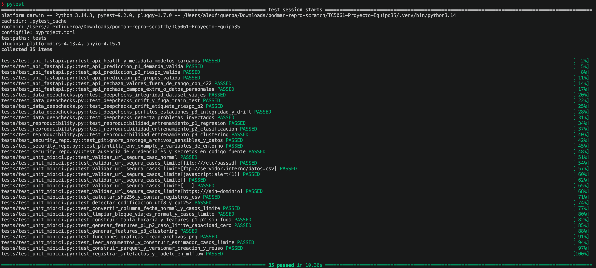
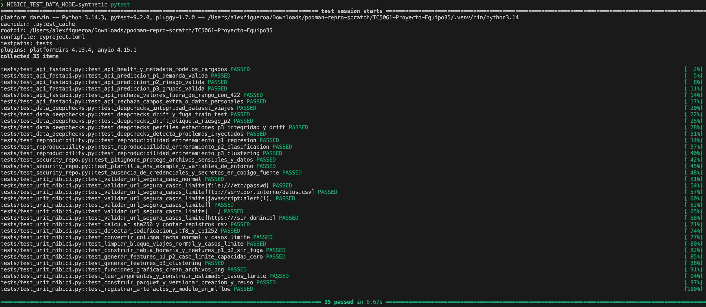
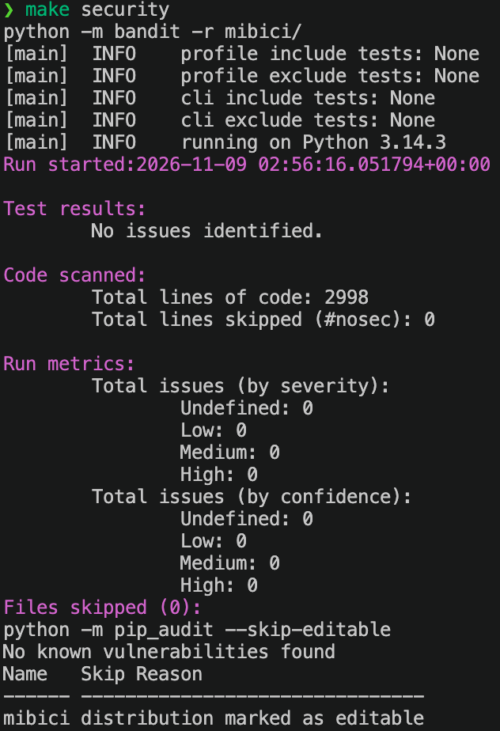

# TC5061 - Proyecto Integrador MiBici (Equipo 35)
## MLflow Project, Tracking Avanzado y Model Registry

Repositorio del **Equipo 35** para el análisis operativo y modelado predictivo del sistema de bicicletas públicas **MiBici** en el Área Metropolitana de Guadalajara (AMG), utilizando datos abiertos del periodo post-pandemia **octubre de 2022 a septiembre de 2026** (48 meses, 17,036,839 viajes limpios, versión de datos `128979137b46`).

---

## 1. Preguntas de Negocio y Tareas de Machine Learning

| Código | Pregunta de Negocio | Tipo de Tarea | Variable Objetivo / Unidad y horizonte | Usuario final y decisión operativa |
| :--- | :--- | :--- | :--- | :--- |
| **P1** | ¿Cuántos viajes se iniciarán en una estación en la siguiente hora? | **Regresión** | `viajes_iniciados` (Estación $\times$ Hora, predicción para la siguiente hora $t$) | **Operador del sistema:** dimensionar la flota activa y anticipar picos horarios de demanda. |
| **P2** | ¿Una estación estará en riesgo de desbalance ($\ge 30\%$ de su capacidad) en la siguiente hora? | **Clasificación binaria** | `en_riesgo` (Estación $\times$ Hora; riesgo $= 1$ si $\Vert{}\text{salidas}_t - \text{llegadas}_t\Vert{} \ge 0.30 \times \text{dpcapacity}$) | **Equipo de rebalanceo:** priorizar el envío de camionetas de redistribución antes de que la estación se vacíe o se sature. |
| **P3** | ¿Qué grupos de estaciones comparten patrones de uso y dónde se ubican en la ciudad? | **Clustering** | Grupos de estaciones (`Estacion_Id`; resumen histórico de comportamiento y coordenadas) | **Planeación urbana y expansión:** diseñar políticas diferenciadas por zona metropolitana y planear nuevas estaciones. |

**Partición estrictamente temporal (sin fuga de información del futuro):**
* **Entrenamiento (Train):** Octubre 2022 – Diciembre 2025 (39 meses).
* **Validación (Validation):** Enero 2026 – Mayo 2026 (5 meses).
* **Prueba (Test):** Junio 2026 – Septiembre 2026 (4 meses).

Se mantienen la misma partición y las mismas métricas de la entrega anterior para que la comparación de cada corrida contra su *baseline* sea válida.

---

## 2. Datos Utilizados y Mecanismo de Versionado

* **Fuente oficial:** Portal de Datos Abiertos de MiBici (`https://mibici.net/es/datos-abiertos/`).
* **Rango temporal seleccionado:** **Octubre de 2022 a Septiembre de 2026** (`2022-10_a_2026-09`, 48 archivos CSV mensuales de viajes más el catálogo `nomenclatura_2026_09.csv`).
* **Justificación del rango:** El 13 de octubre de 2022 se publicó en el Periódico Oficial *El Estado de Jalisco* el Acuerdo Gubernamental `DIELAG ACU 065/2022`, que abrogó las medidas sanitarias obligatorias por COVID-19, normalizando los patrones de movilidad urbana.
* **Volumen y limpieza aplicada (`mibici/dataset.py`):**
  * **Filas crudas leídas:** `17,927,033` registros.
  * **Filas limpias escritas en Parquet:** `17,036,839` registros (se eliminaron `889,481` viajes menores a 121 segundos y `713` duplicados exactos; se estandarizaron `15,859` años de nacimiento fuera de `[1900, 2026]` y `116,260` valores nulos/vacíos de `Genero`).
  * **Estaciones:** `484` estaciones en catálogo (`473` estaciones con viajes activos en el periodo).
  * El detalle de cada regla de limpieza está en `references/README_proceso_datos_mibici.txt`.
* **Mecanismo de versionado (`data/processed/data_version.json`):** Al terminar la ingesta, `mibici/dataset.py` calcula con `hashlib.sha256` el hash criptográfico y el conteo de filas de cada uno de los 48 archivos CSV, del catálogo de nomenclatura y del archivo consolidado `datos_mibici.parquet`. La versión oficial actual de los datos es **`128979137b46`** (primeros 12 caracteres del SHA-256 del Parquet).
* **Trazabilidad en MLflow:** Cada corrida registra la versión de datos como etiqueta y parámetro (`data_version`), sube el manifiesto `data_version.json` como artefacto (`data/`) y registra una muestra del conjunto de entrenamiento con `mlflow.log_input` usando la versión de datos como *digest*.
* **Privacidad:** Los modelos solo usan variables agregadas por estación y hora (o por estación en P3). Las columnas personales (`Usuario_Id`, `Genero`, `Año_de_nacimiento`) nunca se usan como variables ni se registran en MLflow.

---

## 3. Estructura del Repositorio (Cookiecutter Data Science + MLproject)

El proyecto fue generado con `cookiecutter-data-science` (`ccds`) activando `include_code_scaffold = Yes` y se extendió con un MLflow Project:

```text
├── .gitignore               <- Excluye datos crudos/procesados, modelos, mlruns/, mlartifacts/ y mlflow.db
├── LICENSE
├── Makefile                 <- Atajos de línea de comandos para ingesta, servidor y registro
├── MLproject                <- Definición del MLflow Project (entry points: ingest, train, register)
├── python_env.yaml          <- Entorno del MLflow Project con versiones fijas de Python y dependencias
├── pyproject.toml           <- Metadatos del paquete instalable mibici
├── requirements.txt         <- Dependencias fijas con versiones exactas (==)
├── README.md                <- Documentación de reproducción, servidor MLflow y Model Registry
├── data/
│   ├── external/
│   ├── interim/             <- Caché local de tablas de features (ignorado en Git)
│   ├── processed/
│   │   └── data_version.json <- Manifiesto de versión de datos con hashes SHA-256 individuales
│   └── raw/                 <- Archivos CSV mensuales y nomenclatura (ignorados en Git)
├── mibici/
│   ├── __init__.py
│   ├── config.py            <- Configuración centralizada (rutas, fechas, semilla, hiperparámetros y Registry)
│   ├── dataset.py           <- Punto de entrada 'ingest': descarga, limpieza, Parquet y data_version.json
│   ├── features.py          <- Ingeniería de características sin fuga de datos (rezagos temporales .shift)
│   ├── plots.py             <- Generación de gráficas de desempeño para P1, P2 y P3
│   └── modeling/
│       ├── __init__.py
│       ├── train.py         <- Punto de entrada 'train': baselines, nested runs, candidatos y artefactos
│       └── predict.py       <- Punto de entrada 'register': registro en Model Registry (@champion) e inferencia
├── models/                  <- Carpeta para modelos locales (ignorada en Git)
├── notebooks/
│   └── 1.0-equipo35-exploracion-mibici.ipynb
├── references/
│   ├── README_proceso_datos_mibici.txt <- Documentación detallada de las reglas de limpieza
│   ├── arquitectura_equipo35.md        <- Diagrama y justificación de arquitectura
│   └── ml_canvas_equipo35.md           <- ML Canvas del proyecto
└── reports/
    └── figures/             <- Gráficas de desempeño de los modelos de P1, P2 y P3
```
---

## 4. Reproducción desde un Clon Limpio con `mlflow run`

**Paso 1: Clonar el repositorio y crear el entorno virtual**

```bash
git clone https://github.com/figueroa-alex/TC5061-Proyecto-Equipo35.git
cd TC5061-Proyecto-Equipo35

python3 -m venv .venv
source .venv/bin/activate
pip install --upgrade pip
pip install -r requirements.txt
pip install -e .
```

**Paso 2: Levantar el servidor local de MLflow Tracking con SQLite (Terminal 1)**

El Model Registry requiere un almacenamiento respaldado por base de datos. Abre una primera terminal en la raíz del proyecto, activa el entorno y levanta el servidor local en el puerto `5000`:

```bash
source .venv/bin/activate
mlflow server --backend-store-uri sqlite:///mlflow.db --port 5000
```
*(La interfaz web estará disponible en `http://127.0.0.1:5000`. El archivo `mlflow.db` y la carpeta `mlartifacts/` están excluidos en `.gitignore`).*

**Paso 3: Configurar variables de entorno y ejecutar la ingesta con `mlflow run` (Terminal 2)**

Abre una segunda terminal en la raíz del proyecto y apunta `MLFLOW_TRACKING_URI` al servidor local y `MLFLOW_EXPERIMENT_NAME` al experimento del equipo (`mibici-equipo35`):

```bash
source .venv/bin/activate
export MLFLOW_TRACKING_URI="http://127.0.0.1:5000"
export MLFLOW_EXPERIMENT_NAME="mibici-equipo35"

# Ejecutar el punto de entrada 'ingest' (descarga/verifica los 48 CSVs, genera Parquet y data_version.json)
mlflow run . -e ingest --env-manager=local
```

**Paso 4: Reproducir toda la experimentación (Baselines, Nested Runs y Candidatos) con `mlflow run`**

**Pregunta 1 (P1 - Regresión de demanda horaria por estación):**

```bash
# 1. Baseline (DummyRegressor - estrategia de la media)
mlflow run . -e train --env-manager=local -P question=p1 -P stage=baseline -P model=dummy

# 2. Búsqueda de hiperparámetros con Nested Runs (1 corrida padre + 4 corridas hijas)
mlflow run . -e train --env-manager=local -P question=p1 -P stage=search -P model=hgb

# 3. Tres corridas candidatas comparables contra el baseline
mlflow run . -e train --env-manager=local -P question=p1 -P stage=candidate -P model=ridge -P alpha=1.0
mlflow run . -e train --env-manager=local -P question=p1 -P stage=candidate -P model=rf -P n_estimators=150 -P max_depth=12
mlflow run . -e train --env-manager=local -P question=p1 -P stage=candidate -P model=hgb -P n_estimators=250 -P max_depth=12 -P learning_rate=0.08
```

**Pregunta 2 (P2 - Clasificación de riesgo de desbalance horario $\ge 30\%$ de capacidad):**

```bash
# 1. Baseline (DummyClassifier estratificado)
mlflow run . -e train --env-manager=local -P question=p2 -P stage=baseline -P model=dummy

# 2. Búsqueda de hiperparámetros con Nested Runs (1 corrida padre + 4 corridas hijas)
mlflow run . -e train --env-manager=local -P question=p2 -P stage=search -P model=hgb_clf

# 3. Tres corridas candidatas comparables contra el baseline
mlflow run . -e train --env-manager=local -P question=p2 -P stage=candidate -P model=logreg -P c_reg=1.0
mlflow run . -e train --env-manager=local -P question=p2 -P stage=candidate -P model=rf_clf -P n_estimators=150 -P max_depth=12
mlflow run . -e train --env-manager=local -P question=p2 -P stage=candidate -P model=hgb_clf -P n_estimators=250 -P max_depth=12 -P learning_rate=0.08
```

**Pregunta 3 (P3 - Clustering de estaciones por perfil operativo y geográfico):**

```bash
# 1. Baseline (K-Means con K=2)
mlflow run . -e train --env-manager=local -P question=p3 -P stage=baseline -P model=kmeans -P n_clusters=2

# 2. Búsqueda de hiperparámetros con Nested Runs (1 corrida padre + 4 corridas hijas para K=3,4,5,6)
mlflow run . -e train --env-manager=local -P question=p3 -P stage=search -P model=kmeans

# 3. Tres corridas candidatas comparables contra el baseline
mlflow run . -e train --env-manager=local -P question=p3 -P stage=candidate -P model=kmeans -P n_clusters=4
mlflow run . -e train --env-manager=local -P question=p3 -P stage=candidate -P model=minibatch_kmeans -P n_clusters=4
mlflow run . -e train --env-manager=local -P question=p3 -P stage=candidate -P model=birch -P n_clusters=4
```

**Paso 5: Consultar la tabla comparativa de corridas (opcional, en cualquier momento)**

```bash
mlflow run . -e register --env-manager=local -P action=summary
```

Imprime en la terminal todas las corridas finalizadas por pregunta (baseline, búsqueda con sus corridas hijas y candidatas) con sus métricas, para apoyar la comparación en la interfaz de MLflow (`http://127.0.0.1:5000`, experimento `mibici-equipo35`).

---

## 5. Gestión del Model Registry y Esquema de Ciclo de Vida (Aliases)

Una vez entrenadas todas las corridas y elegido el modelo de cada pregunta, se promueven a producción y se verifica que se pueden cargar por su nombre y alias:

```bash
mlflow run . -e register --env-manager=local -P action=register_and_verify
```

> **Registro automático:** para cada pregunta, el script toma las corridas con `stage_of_work = candidate` y estado `FINISHED`, asigna `@champion` a la mejor y `@challenger` a la segunda según la métrica de validación (P1: menor `val_mae`; P2: mayor `val_f1`; P3: mayor `train_silhouette`). Antes de ejecutarlo, el equipo confirma que este orden coincide con el modelo elegido y justificado en el reporte. Se ejecuta **una sola vez** en el servidor oficial, porque cada ejecución crea nuevas versiones en el registro.

**Modelos registrados y URIs de producción**

| Pregunta | Nombre en el Model Registry | Alias en Producción | URI de Carga |
| :---- | :---- | :---- | :---- |
| **P1 (Demanda)** | `mibici-equipo35-p1-demanda` | `@champion` | `models:/mibici-equipo35-p1-demanda@champion` |
| **P2 (Riesgo)** | `mibici-equipo35-p2-riesgo` | `@champion` | `models:/mibici-equipo35-p2-riesgo@champion` |
| **P3 (Grupos)** | `mibici-equipo35-p3-grupos` | `@champion` | `models:/mibici-equipo35-p3-grupos@champion` |

**Justificación del esquema de ciclo de vida mediante Aliases (`@champion` y `@challenger`)**

El equipo adoptó el esquema vigente de Model Registry Aliases (`@champion` para la versión activa en producción y `@challenger` para la segunda mejor versión candidata) en lugar del esquema clásico de etapas (Staging / Production / Archived), el cual se encuentra deprecado a partir de MLflow 2.9+ y 3.x:

1. **Desacoplamiento entre código consumidor y versiones numéricas:** Los sistemas de inferencia (`mibici/modeling/predict.py`) invocan una URI fija (`models:/mibici-equipo35-p1-demanda@champion`). Al actualizar el modelo, basta con reasignar el alias `@champion` a la nueva versión sin modificar el código de producción.

2. **Reversión inmediata (*Rollback*) y pruebas A/B (*Shadow Deployment*):** Mantener asignado el alias `@challenger` al modelo retador permite comparar en paralelo dos modelos candidatos o revertir instantáneamente el puntero `@champion` en caso de degradación operativa.

3. **Linaje completo:** Cada versión registrada conserva sus etiquetas de `git_commit`, `data_version` (`128979137b46`), `run_id` de origen e identificador del experimento `mibici-equipo35`.

---

## 6. Artefactos por Corrida y Gráficas del Reporte

Cada corrida *baseline* y candidata guarda en MLflow los artefactos que respaldan su resultado, organizados en subcarpetas:

| Ubicación en MLflow | Contenido |
| :--- | :--- |
| `data/data_version.json` | Manifiesto de versión de datos generado por la ingesta |
| `config/config.py` y `config/run_config.json` | Configuración del proyecto y parámetros exactos de la corrida |
| `plots/` | Dos gráficas por pregunta: real vs. predicho y residuales (P1), matriz de confusión y curva precisión-recall (P2), mapa y perfiles de los grupos de estaciones (P3) |
| *Logged model* (sección **Logged models** de la corrida) | Modelo registrado con `log_model`, con firma (*signature*) y ejemplo de entrada |
| *Datasets* | Muestra del conjunto de entrenamiento registrada con `mlflow.log_input` (sin datos personales) |

Las corridas de búsqueda (padre e hijas) solo registran parámetros y métricas: son exploratorias, y la mejor combinación se vuelve a entrenar como corrida candidata con todos sus artefactos.

**Gráficas versionadas en Git (`reports/figures/`).** Cada corrida sobrescribe localmente las dos gráficas de su pregunta (`p1_*`, `p2_*` o `p3_*`). El título de cada imagen indica el modelo que la generó. Las gráficas de todas las demás corridas se conservan en MLflow, en la subcarpeta `plots/` de cada corrida.

---

## 7. Flujo de Trabajo Colaborativo con Git y GitHub (Equipo 35)

El equipo adoptó **GitHub Flow** con las siguientes reglas:

1. **Protección de la rama `main`:** La rama `main` está protegida en GitHub y prohíbe *pushes* directos; todo cambio requiere abrir un *Pull Request* (PR) y contar con al menos **1 revisión y aprobación** de otro integrante antes de fusionarse (*merge*).
2. **Convención de nombres de ramas:** Se utiliza el formato `<tipo>/<descripcion-corta-en-kebab-case>`, por ejemplo:
   * Entrega 1: `feat/ingesta-y-configuracion`, `feat/ingenieria-caracteristicas`, `feat/experimento-base-mlflow`, `docs/readme-y-documentacion`.
   * Entrega 2: `feat/mlflow-project-infra`, `feat/experimentacion-artefactos`, `feat/model-registry`, `docs/readme-reporte-entrega2`.
3. **Convención de mensajes de commit:** Basada en *Conventional Commits* 1.0.0 (`feat:`, `fix:`, `docs:`, `refactor:`, `chore:`) seguidos de una descripción concisa en español.
4. **Fusión con *merge commit*:** Los PR se fusionan con *merge commit* (sin *squash*) para conservar los *commits* que quedan registrados en la etiqueta `git_commit` de cada corrida y versión del Model Registry.
5. **Exclusión de artefactos pesados:** El archivo `.gitignore` bloquea cualquier archivo `.csv`, `.parquet`, modelos serializados, `mlruns/`, `mlartifacts/` y `mlflow.db` para mantener el repositorio ligero y auditable.

---

## 8. Equipo 35

| Nombre | Matrícula | Rol |
|---|---|---|
| Alejandro Figueroa Martínez | A01796930 | Científico de Datos |
| Fernando Gómez Moreno | A00354097 | Ingeniero de Datos |
| Luis Pablo Guerrero Garza | A01840428 | Ingeniero de Machine Learning |
| Rosina Flores Ruiz | A01639950 | Analista de Datos |

---

## 9. Pruebas Automatizadas (PyTest + DeepChecks) y Chequeos de Seguridad

En esta entrega se integró al repositorio una suite automatizada de **25 pruebas** en la carpeta dedicada `tests/` junto con controles de seguridad de código, variables de entorno y auditoría de dependencias para asegurar la calidad, reproducibilidad y gobernanza técnica del proyecto MiBici.

### 9.1 Estructura de la Carpeta `tests/`

```text
tests/
├── __init__.py               <- Inicializador del paquete de pruebas
├── conftest.py               <- Fixtures deterministas (semilla 42) y puente de compatibilidad para DeepChecks
├── test_unit_mibici.py       <- 16 pruebas unitarias (casos normales y casos límite) de dataset.py, features.py, plots.py y train.py
├── test_reproducibility.py   <- 3 pruebas de reproducibilidad del entrenamiento (P1 Regresión, P2 Clasificación, P3 Clustering)
├── test_data_deepchecks.py   <- 3 pruebas de validación de integridad, calidad y drift del dataset con DeepChecks
└── test_security_repo.py     <- 3 pruebas automatizadas de seguridad (.gitignore, .env.example y ausencia de secretos)
```

---

### 9.2 Cobertura de Pruebas Unitarias y de Reproducibilidad con PyTest (`tests/test_unit_mibici.py` y `tests/test_reproducibility.py`)

| Módulo / Función Clave Probada | Casos Normales Cubiertos | Casos Límite (*Edge Cases*) Cubiertos |
| :--- | :--- | :--- |
| `dataset.validar_url_segura` | Aceptación de URLs oficiales con esquema `https://` y `http://` y dominio válido. | Rechazo con `ValueError` de esquemas no permitidos (`file:///etc/passwd`, `ftp://`, `javascript:`), cadenas vacías o con espacios y URLs sin dominio (`https:///sin-dominio`). |
| `dataset.calcular_sha256_archivo` y `contar_registros_csv` | Cálculo exacto de hash SHA-256 por bloques y conteo de filas de datos descontando el encabezado. | Archivos CSV completamente vacíos (`0 bytes`), devolviendo `0` registros sin producir conteos negativos. |
| `dataset.detectar_codificacion` y `convertir_columna_fecha` | Detección automática `utf-8-sig` vs. `cp1252` (letra `ñ`) y conversión de fechas en formatos ISO (`YYYY-MM-DD HH:MM:SS`) y día-primero (`DD/MM/YYYY HH:MM`). | Series de fecha completamente vacías o con espacios (`NaT`) y rechazo con `ValueError` ante formatos de fecha corruptos o desconocidos. |
| `dataset.limpiar_bloque_viajes` | Conversión de tipos a `Int64`, conservación de viajes válidos ($\ge 121\text{ s}$) y conteo de estadísticas de limpieza. | Eliminación de viajes cortos ($< 121\text{ s}$) y duplicados exactos; enmascaramiento a `pd.NA` de años de nacimiento fuera de `[1900, 2026]` (ej. `1850`, `2099`) y de cadenas `'NULL'`/`''` en `Genero`; manejo seguro de un `DataFrame` vacío (`0` filas). |
| `features.construir_tabla_horaria_estaciones` y `generar_features_p1_y_p2` | Agregación horaria por estación, creación de variables de calendario, rezagos temporales (`.shift(1)`, `.shift(2)`, `.shift(24)`), promedio móvil de 3 horas y etiqueta binaria `en_riesgo`. | Verificación matemática contra fuga de datos (*data leakage*) comprobando que `lag_1_iniciados` en la hora $t$ coincida exactamente con `viajes_iniciados` en $t-1$; manejo seguro de estaciones con capacidad cero (`dpcapacity = 0`) evitando divisiones por cero (`ZeroDivisionError`) o valores infinitos. |
| `features.generar_features_p3_clustering` | Construcción del perfil operativo y geográfico por estación sobre el conjunto de entrenamiento. | Estaciones sin llegadas registradas (reemplazo seguro de denominador `0` por `1` en `ratio_salidas_llegadas`) y validación de proporciones en el rango `[0.0, 1.0]`. |
| `plots.*` y `train.leer_argumentos` / `construir_estimador` | Creación de archivos `.png` no vacíos para P1 y P2; reemplazo automático de `"from_config"` por las constantes de `mibici/config.py`. | Rechazo con `ValueError` ante preguntas o nombres de modelos no reconocidos (`p99`, `modelo_inexistente`). |
| **Reproducibilidad del entrenamiento** (`test_reproducibility.py`) | Dos ejecuciones independientes con la misma semilla (`RANDOM_SEED = 42`) para **P1** (`HistGradientBoostingRegressor`, `RandomForestRegressor`, `Ridge`), **P2** (`HistGradientBoostingClassifier`, `LogisticRegression`, `RandomForestClassifier`) y **P3** (`KMeans`). | Verificación estricta con `np.testing.assert_allclose` (`rtol=1e-12`, `atol=1e-12`) y `assert_array_equal` de que dos corridas con la misma semilla producen **exactamente las mismas predicciones, probabilidades, asignaciones de cluster y métricas** (`MAE`, `R2`, `F1-Score`, `ROC-AUC` y `Silhouette Score`). |

---

### 9.3 Validación de Calidad, Integridad y *Drift* de Datos con DeepChecks (`tests/test_data_deepchecks.py`)

Las pruebas de `DeepChecks` soportan **dos modos de ejecución** controlados mediante la variable de entorno `MIBICI_TEST_DATA_MODE` (definida en `.env.example` y `mibici/config.py`):

1. **Modo Muestra Real (`MIBICI_TEST_DATA_MODE=real` o `auto` cuando existen los archivos Parquet en disco):** Evalúa una muestra determinista de `10,000` viajes limpios de `data/processed/datos_mibici.parquet` y muestras de `5,000` observaciones de entrenamiento vs. `5,000` de prueba de `data/interim/features_p1_p2.parquet`.
2. **Modo Sintético de Respaldo (`MIBICI_TEST_DATA_MODE=synthetic` o `auto` en un clon limpio antes de correr la ingesta):** Evalúa el *dataset* sintético determinista generado en `tests/conftest.py` para que `pytest` sea ejecutable con un solo comando inmediatamente después de clonar el repositorio, incluso antes de descargar los 48 archivos CSV.

#### Hallazgos Documentados de DeepChecks sobre el Dataset Real (Versión `128979137b46`)

| Chequeo de DeepChecks | Dataset Evaluado | Resultado Obtenido | Interpretación Técnica y de Negocio |
| :--- | :--- | :--- | :--- |
| `IsSingleValue` | `datos_mibici.parquet` (muestra $n=10,000$) | `0` columnas constantes (`Usuario_Id: 4,582`, `Genero: 3`, `Año_de_nacimiento: 62`, `Origen_Id: 299`, `Destino_Id: 300`). | Todas las variables conservan variabilidad informativa tras el proceso de limpieza. |
| `MixedNulls` | `datos_mibici.parquet` (muestra $n=10,000$) | `Año_de_nacimiento`: `36` valores `NaN` (`0.36%`); `0` tipos de nulos mezclados en las demás columnas. | Confirma que `dataset.py` homologó las cadenas `'NULL'` y vacías a un único tipo nulo estándar y enmascaró como `NaN` los años fuera de `[1900, 2026]`. |
| `MixedDataTypes` | `datos_mibici.parquet` y dataset con anomalías inyectadas | `{}` (`0` columnas con tipos mezclados en el Parquet limpio). Detecta tipos mezclados cuando se inyecta un entero en `Genero`. | Garantiza la integridad de tipos del esquema Parquet (`int64`, `float64`, `datetime64` y `object`). |
| `StringMismatch` y `SpecialCharacters` | `datos_mibici.parquet` (muestra $n=10,000$) | `Genero`: `{}` (`0.0%` de variantes con errores o caracteres especiales). | Confirma la estandarización de categorías en la columna `Genero`. |
| `DataDuplicates` | `datos_mibici.parquet` y dataset con anomalías inyectadas | `0.0%` de duplicados exactos al incluir `Viaje_Id` y fechas; `2.24%` al evaluar solo el perfil `(Usuario_Id, Genero, Año, Origen_Id, Destino_Id)`. | La ingesta eliminó los `713` duplicados exactos crudos. El `2.24%` sin fecha ni ID corresponde a usuarios recurrentes que realizan el mismo trayecto origen-destino en días diferentes. |
| `OutlierSampleDetection` | Dataset de prueba con anomalías inyectadas ($n=120$) | Vector de `1,000` cuantiles LoOP con probabilidad máxima `0.7871` (`> 0.50`). | Confirma que el detector multivariado LoOP identifica registros con conteos de viajes atípicos extremos. |
| `TrainTestSamplesMix` | `features_p1_p2.parquet` (Train vs. Test, $n=5,000$ c/u) | `ratio = 0.0` (`0.0%` de muestras compartidas entre Train y Test). | Comprueba la ausencia de filtración de muestras entre el conjunto de entrenamiento (Oct 2022–Dic 2025) y el de prueba (Jun–Sep 2026). |
| `FeatureDrift` | `features_p1_p2.parquet` (Train vs. Test, $n=5,000$ c/u) | Variables operativas estables ($< 0.07$): `hora = 0.0075`, `dia_semana = 0.0000`, `es_fin_de_semana = 0.0000`, `es_hora_pico = 0.0011`, `lag_1_iniciados = 0.0326`, `dpcapacity = 0.0460`. Variable calendario `mes = 0.7299` (V de Cramer). | El *drift* alto en `mes` (`0.7299`) es esperado por diseño de la partición temporal: Test abarca únicamente junio–septiembre de 2026 (4 meses), mientras que Train abarca los 12 meses del año. Las variables predictoras operativas y de capacidad mantienen distribuciones estables. |
| `LabelDrift` | `features_p1_p2.parquet` (`viajes_iniciados`) | `Drift score = 0.0532` (prueba de Kolmogorov-Smirnov $< 0.20$). | La distribución de la variable objetivo `viajes_iniciados` se mantiene estable entre entrenamiento y prueba. |

---

### 9.4 Chequeos de Seguridad Básicos Implementados

1. **Protección de credenciales y variables de entorno (`.gitignore`, `.env.example` y `mibici/config.py`):**
   * Se integró la plantilla `.env.example` con las variables de entorno del proyecto (`MLFLOW_TRACKING_URI`, `MLFLOW_EXPERIMENT_NAME`, `MIBICI_OPEN_DATA_URL`, `MIBICI_RANDOM_SEED` y `MIBICI_TEST_DATA_MODE`) sin exponer secretos.
   * `mibici/config.py` carga automáticamente las variables desde `.env` mediante `python-dotenv` (`load_dotenv`) y `os.getenv()`.
   * `.gitignore` excluye archivos `.env`, `.env.*` (permitiendo solo `!.env.example`), llaves privadas (`*.pem`, `*.key`, `*.crt`), bases de datos (`mlflow.db`) y archivos de datos (`*.csv`, `*.parquet`).
   * El módulo `tests/test_security_repo.py` verifica en cada corrida de `pytest` que `.gitignore` y `.env.example` estén presentes y escanea todos los archivos `.py` para confirmar la ausencia de tokens (`ghp_`, `AKIA`, `sk-`), llaves privadas o contraseñas escritas en el código.
2. **Análisis estático de seguridad del código fuente con `bandit`:**
   * En la auditoría inicial sobre `mibici/`, `bandit` detectó **5 alertas**: 2 de severidad Media (`B310` en `mibici/dataset.py` por uso de `urlopen` sin validar el esquema de la URL) y 3 de severidad Baja (`B404`, `B603`, `B607` en `mibici/modeling/train.py` por uso de `subprocess.check_output` para leer el hash de Git).
   * **Remediación aplicada:** Se implementó `dataset.validar_url_segura(url)` para permitir exclusivamente esquemas `https` y `http` con dominio válido antes de cualquier descarga, y en `train.py` se sustituyó `subprocess` por `GitPython` (`git.Repo`). Tras estos cambios, `bandit -r mibici/` reporta **0 problemas de seguridad** en las 2,341 líneas de código analizadas.
3. **Auditoría de vulnerabilidades en dependencias con `pip-audit`:**
   * En la revisión inicial del entorno con `pip-audit`, se detectaron vulnerabilidades conocidas en `certifi` (`PYSEC-2026-4320`), `mlflow` (`CVE-2026-53995`), `setuptools` (`PYSEC-2026-3447`, `GHSA-xmj3-9gf7-h52w`),  `tornado` (`CVE-2026-116577`) y `pyasn1` (`CVE-2026-119194`, `CVE-2026-119195`, `CVE-2026-119196`, `CVE-2026-119197`).
   * **Remediación aplicada:** Se actualizaron y fijaron en `requirements.txt` las versiones parcheadas (`certifi==2026.10.23`, `mlflow==3.17.2`, `setuptools==84.2.1`, `tornado==6.6` y `pyasn1==0.6.5`), logrando un resultado limpio de **`No known vulnerabilities found`**.

---

### 9.5 Instrucciones para Ejecutar las Pruebas y los Chequeos de Seguridad

Desde la raíz del repositorio con el entorno virtual activado (`source .venv/bin/activate`):

#### A) Ejecutar la suite completa de pruebas con un solo comando (PyTest + Reproducibilidad + DeepChecks + Seguridad)

* **Modo 1 — Con muestra representativa del archivo Parquet real (`data/processed/datos_mibici.parquet`):**
  Si ya ejecutaste la ingesta de datos (`mlflow run . -e ingest --env-manager=local`), corre:
  ```bash
  pytest
  # O mediante el comando del Makefile:
  make test-real
  ```

* **Modo 2 — Con dataset sintético de respaldo (en un clon limpio sin haber ejecutado aún la ingesta):**
  Si acabas de clonar el repositorio y deseas correr todas las pruebas de inmediato sin descargar los 48 archivos CSV ni generar el Parquet, ejecuta:
  ```bash
  MIBICI_TEST_DATA_MODE=synthetic pytest
  # O mediante el comando del Makefile:
  make test-synthetic
  ```

#### B) Ejecutar los chequeos de seguridad de código (`bandit`) y de dependencias (`pip-audit`)

```bash
# 1. Análisis de seguridad del código fuente en mibici/
bandit -r mibici/

# 2. Auditoría de vulnerabilidades en dependencias instaladas
pip-audit --skip-editable

# O ejecutar ambos chequeos con un solo comando del Makefile:
make security
```

---

### 9.6 Evidencia de Ejecución Exitosa de Pruebas y Chequeos de Seguridad

**1. Ejecución exitosa de las 25 pruebas automatizadas (PyTest + Reproducibilidad + DeepChecks + Seguridad) sobre la muestra de datos reales (`25 passed in 4.70s`):**



**2. Ejecución exitosa de las 25 pruebas automatizadas usando el dataset sintético de respaldo (`MIBICI_TEST_DATA_MODE=synthetic pytest`, `25 passed in 3.31s`):**



**3. Ejecución exitosa de los chequeos de seguridad con `bandit` (`No issues identified`) y `pip-audit` (`No known vulnerabilities found`):**



---

## 10. Referencias Bibliográficas

* Acuerdo DIELAG ACU 065/2022. (2022, 13 de octubre). Acuerdo del Ciudadano Gobernador Constitucional del Estado Libre y Soberano de Jalisco, mediante el cual se abroga el diverso acuerdo DIELAG ACU 016/2022. *Periódico Oficial "El Estado de Jalisco"*, Tomo CDV(28, Sección IV), 3–5.
* Conventional Commits. (s.f.). *Conventional Commits 1.0.0* [Especificación]. https://www.conventionalcommits.org/es/v1.0.0/
* Deepchecks. (2024). *Deepchecks documentation: Continuous validation for machine learning*. https://docs.deepchecks.com/stable/getting-started/welcome.html
* DrivenData. (2024). *Cookiecutter Data Science* (Versión 2) [Documentación]. https://cookiecutter-data-science.drivendata.org/
* Google. (2026). Gemini (basado en Gemini 3.8) [Modelo de lenguaje grande], utilizado para la revisión de redacción.
* Grossmann, J., Wiesbrock, H., & Motta, M. (2021). *Testing ML-based systems*. European Telecommunications Standards Institute (ETSI).
* Huyen, C. (2022). *Designing machine learning systems: An iterative process for production-ready applications*. O'Reilly Media.
* Krekel, H., Oliveira, B., Pfannschmidt, R., Bruynooghe, F., Laugher, B., & Bruhin, F. (2024). *pytest: Helps you write better programs*. https://docs.pytest.org/en/stable/
* Lakshmanan, V., Robinson, S., & Munn, M. (2020). *Machine learning design patterns: Solutions to common challenges in data preparation, model building, and MLOps*. O'Reilly Media.
* MiBici. (2026). *Datos abiertos del sistema de bicicletas públicas MiBici* [Conjunto de datos]. Agencia Metropolitana de Servicios de Infraestructura para la Movilidad del Área Metropolitana de Guadalajara. https://mibici.net/es/datos-abiertos/
* MLflow. (2024). *MLflow documentation: MLflow Tracking and Model Registry*. https://mlflow.org/docs/latest/index.html
* Pedregosa, F., Varoquaux, G., Gramfort, A., Michel, V., Thirion, B., Grisel, O., Blondel, M., Prettenhofer, P., Weiss, R., Dubourg, V., Vanderplas, J., Passos, A., Cournapeau, D., Brucher, M., Perrot, M., & Duchesnay, É. (2011). Scikit-learn: Machine learning in Python. *Journal of Machine Learning Research*, 12(85), 2825–2830. http://jmlr.org/papers/v12/pedregosa11a.html
* PyCQA. (2024). *Bandit: A tool designed to find common security issues in Python code*. Python Code Quality Authority. https://bandit.readthedocs.io/en/latest/
* Python Packaging Authority. (2024). *pip-audit: Audits Python environments and dependency trees for known vulnerabilities*. https://pypi.org/project/pip-audit/
* Treveil, M., Omont, N., Stenac, C., Lefevre, K., Phan, D., Zentici, J., Lavoillotte, A., Miyazaki, M., & Heidmann, L. (2020). *Introducing MLOps: How to scale machine learning in the enterprise*. O'Reilly Media.
* Wilson, B. (2022). *Machine learning engineering in action*. Manning Publications.